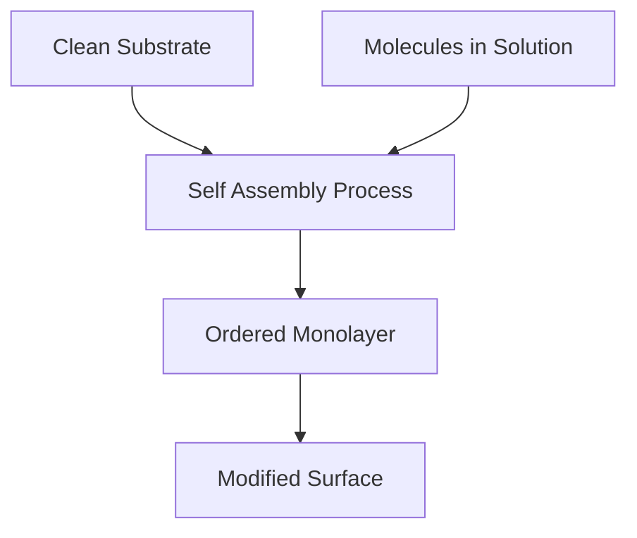

It's Nobel season, and the air in the chemistry world is thick with anticipation! As of October 4, 2026, the scientific community is buzzing with predictions for the highly coveted Nobel Prize in Chemistry, with the official announcement just days away on October 7. Among the front-runners highlighted by Clarivate's Citation Laureates are pioneering researchers in the field of Self-Assembled Monolayers (SAMs).

Self-Assembled Monolayers represent a fascinating area of surface chemistry where molecules spontaneously arrange themselves into an ordered, single-layer film on a substrate. This phenomenon allows for the precise modification of surfaces, tailoring their chemical and physical properties for a myriad of applications. Think of it as molecular-level engineering, creating ultra-thin coatings with specific functionalities.

Researchers like David Allara, Ralph Nuzzo, and Jacob Sagiv are recognized for their foundational work in developing and understanding these incredible structures. Their contributions have paved the way for advancements in diverse fields, from creating biosensors and controlling friction to developing protective coatings and enhancing electronic devices. The elegance of SAMs lies in their simplicity of formation—often involving a substrate immersed in a dilute solution of molecules—yet yielding structures with profound implications.

The ability to precisely control surface properties at the nanoscale opens doors to innovative solutions for real-world challenges, underscoring why SAMs are considered a "Nobel class" contribution to chemistry. Whether it's enabling more efficient energy technologies or improving medical diagnostics, the impact of self-assembled monolayers continues to grow, demonstrating the transformative power of fundamental chemical discoveries.

