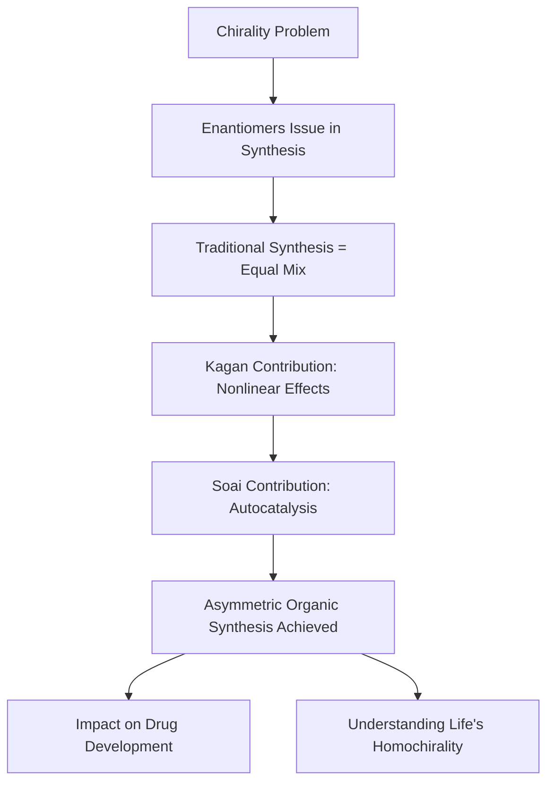

### Chemistry's Century-Old Mystery Solved: 2026 Nobel Prize Honors Asymmetric Synthesis

**October 7, 2026** – The Royal Swedish Academy of Sciences today announced that the Nobel Prize in Chemistry 2026 has been awarded to French chemist Henri B. Kagan and Japanese chemist Kenso Soai. The duo is recognized for their groundbreaking discoveries in non-linear effects and autocatalysis in asymmetric organic synthesis, a field that has profoundly impacted pharmaceutical development and shed light on the origins of life's molecular asymmetry.

Many molecules exist in two forms that are mirror images of each other, much like a left and a right hand. These "enantiomers" can have vastly different effects in biological systems; for instance, one form of a drug might be therapeutic, while its mirror image could be ineffective or even harmful. For decades, chemists faced the challenge of synthesizing only the desired enantiomer, as traditional reactions typically produced an equal mixture of both.

Kagan made the first significant breakthrough in 1986 by discovering "non-linear effects" in asymmetric catalysis. He showed that a small imbalance in a chiral catalyst could be amplified to produce a much greater excess of one mirror-image product, exceeding previous expectations. Building on this, Soai introduced the remarkable concept of "autocatalysis" in 1995. He designed a reaction where the product itself acts as a catalyst for its own formation, leading to an extraordinary amplification of chirality, eventually achieving reactions that produced almost exclusively one enantiomer by 2003.

These discoveries provided a solution to a century-old chemical mystery: how "homochirality"—the overwhelming use of only one mirror-image form of molecules in living organisms—could spontaneously emerge. The work of Kagan and Soai has been transformative for chemists, particularly in the design and manufacturing of pharmaceuticals, flavors, and scents, ensuring the production of safe and effective compounds.

