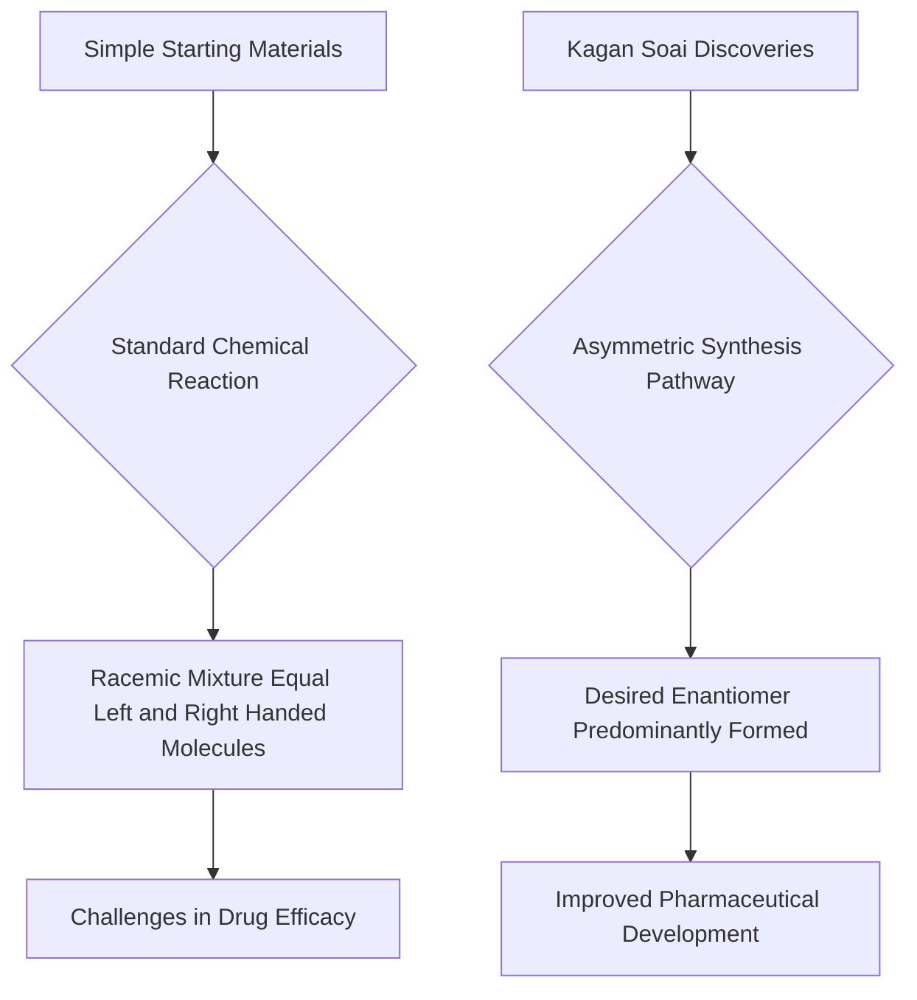

## Chemistry's Mirror Image Mystery Solved: Kagan and Soai Awarded 2026 Nobel Prize

**Stockholm, Sweden – October 11, 2026** – The world of chemistry is abuzz with the recent announcement of the 2026 Nobel Prize in Chemistry, awarded to Professor Henri B. Kagan and Professor Kenso Soai. Their groundbreaking work on "non-linear effects and autocatalysis in asymmetric organic synthesis" has provided crucial insights into the perplexing world of mirror-image molecules and their profound impact on life and medicine.

Many molecules exist as two variants that are each other's mirror image, much like our left and right hands. These are known as enantiomers. While seemingly identical, these "handed" molecules can behave very differently when interacting with living systems. A prime example is in pharmaceuticals, where one mirror image might offer a therapeutic effect, while its counterpart could be ineffective or even harmful. Living organisms themselves exhibit a phenomenon called homochirality, predominantly utilizing only one of these mirror-image forms for essential molecules like amino acids and sugars.

For decades, chemists faced a significant challenge: standard laboratory reactions often produced equal proportions of both mirror images, a mixture known as a racemic mixture. The mystery of how nature achieves homochirality and how to replicate it in the lab remained largely unsolved.

Henri B. Kagan took the first decisive step in 1986, discovering a novel way to manipulate chemical reactions to produce a greater excess of one mirror image than previously thought possible. Building on this, Kenso Soai made a monumental breakthrough in 1995 and 2003. He designed the first chemical reaction, famously known as the Soai reaction, that could efficiently produce only one of the two possible mirror images, essentially creating homochirality spontaneously from non-chiral starting materials. This was a feat previously only observed in nature.

The discoveries by Kagan and Soai have been transformative, particularly for the pharmaceutical industry, enabling the targeted synthesis of desired enantiomers for drug development. Their work also provides fundamental tools for understanding the origin of life's chirality, a question that continues to fascinate scientists worldwide.

The impact of their research can be visualized as moving from uncontrolled outcomes to precise, "handed" synthesis:

