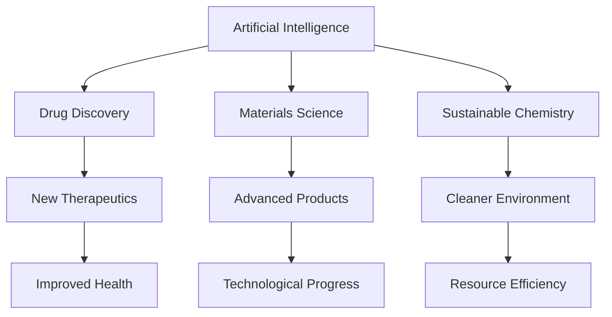

## Chemistry in 2026: A Snapshot of Innovation and Impact

As of October 12, 2026, the world of chemistry is a vibrant hub of innovation, driven by breakthroughs in artificial intelligence, a relentless push for sustainability, and the development of revolutionary new materials. Researchers worldwide are harnessing these advancements to tackle some of humanity's most pressing challenges, from health to environmental protection.

### AI: The Catalyst for Discovery
Artificial intelligence is rapidly transforming every facet of chemical research. In drug discovery, AI models are accelerating the design of novel molecules, predicting how compounds interact with proteins, and significantly reducing experimental failure rates. This has led to faster "design-make-test-analyze" cycles, compressing timelines from months to weeks. Beyond pharmaceuticals, AI is crucial in predicting molecular properties, reaction outcomes, and optimal synthesis pathways. The integration of AI with chemical data analysis, reaction planning, and property prediction is enabling significant advancements, paving the way for self-driving laboratories and inverse design frameworks.

### The Green Chemistry Imperative
Sustainable chemistry continues to be a central focus, with significant strides in developing eco-friendly processes and materials. Companies are increasingly adopting green chemistry principles, moving away from petroleum-based feedstocks towards bio-based alternatives derived from sources like sugarcane and agricultural waste. Innovations in carbon capture, such as new metal-organic frameworks (MUF-16), are setting benchmarks for selective CO2 removal. Researchers are also developing biodegradable vinyl copolymers using AI and real-time automation, offering a promising solution to the global plastic pollution crisis. Even waste products like coconut husk are being valorized into activated carbon for sustainable water purification, effectively removing pharmaceutical pollutants.

### Advanced Materials Shaping Our Future
The quest for novel materials with enhanced properties is yielding exciting results. Nanomaterials are making significant inroads, particularly in energy storage, with silicon nanofibers being used to create anodes for lithium-ion batteries that offer greater storage capacity and more recharge cycles than traditional graphite anodes. Smart materials and advanced composites are evolving rapidly, finding applications in diverse sectors, from health (e.g., artificial organs, regenerative implants) to construction and aviation, promising lighter, stronger, and more durable products. Biohybrid devices, like semi-artificial leaves, are demonstrating the potential to convert sunlight directly into chemical energy, producing clean fuels like hydrogen and formate without harmful chemicals. Furthermore, new catalyst designs are pushing the boundaries of green industrial chemical production, as seen in a recent breakthrough for acetaldehyde synthesis from bioethanol that achieved high yields at lower temperatures.

These interconnected areas underscore a dynamic period in chemistry, where innovation is not only rapid but also deeply integrated across disciplines, promising a future of smarter, healthier, and more sustainable living.

