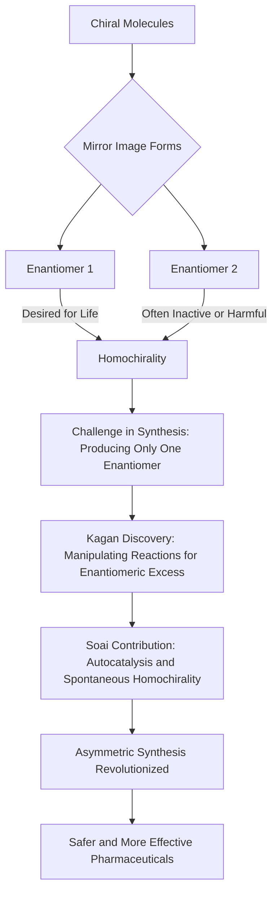

### 2026 Nobel Prize in Chemistry: Unlocking Life's Chiral Secrets

As of October 16, 2026, the chemistry world is abuzz with the announcement of the 2026 Nobel Prize in Chemistry, awarded to **Henri B. Kagan** and **Kenso Soai**. Their groundbreaking work on non-linear effects and autocatalysis in asymmetric organic synthesis has finally solved a century-old mystery: how homochirality can emerge spontaneously.

Many molecules, crucial for life, exist in two forms that are mirror images of each other, much like our left and right hands. These are called chiral molecules, and their mirror-image counterparts are known as enantiomers. Living organisms, however, almost exclusively utilize only one of these mirror images, a phenomenon known as homochirality. For instance, the proteins in our bodies are built solely from "left-handed" amino acids. Historically, chemists faced a significant challenge in producing only the desired mirror image in the lab, as reactions often yielded equal proportions of both.

This control is especially critical in the pharmaceutical industry. Different enantiomers of a drug can have vastly different, sometimes dangerous, effects on the human body. Kagan and Soai's discoveries have been pivotal in enabling chemists to direct chemical reactions to selectively produce one mirror image over the other. Henri Kagan took the first decisive step in 1986 by finding a new way to manipulate reactions to create a greater excess of one mirror image. Kenso Soai further advanced this in 1995 and 2003, designing the first chemical reactions capable of producing only one of the two possible mirror images spontaneously.

Their breakthroughs have revolutionized the design and manufacture of pharmaceuticals, making everyday medicines safer and more effective by ensuring only the beneficial molecular form is produced.

