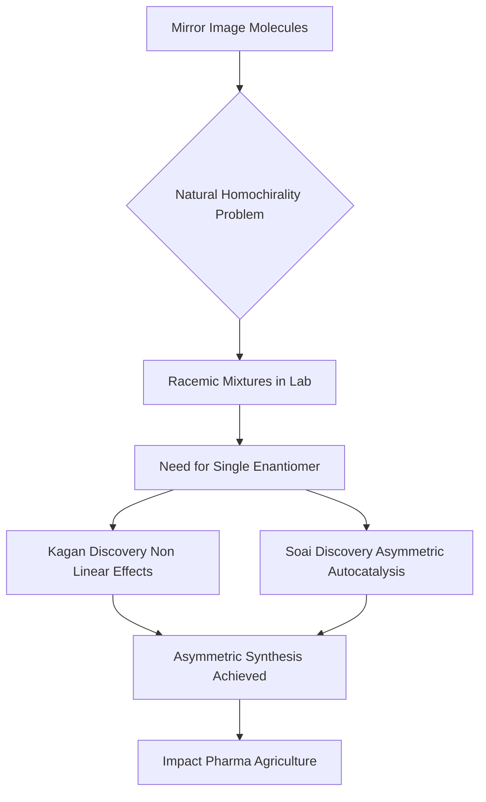

## Chemistry's Latest Triumph: Unlocking Life's Mirror-Image Mystery

**October 20, 2026** – The world of chemistry is buzzing with the recent announcement of the 2026 Nobel Prize in Chemistry, awarded to Henri B. Kagan of Université Paris-Sud and Kenso Soai of Tokyo University of Science. Their groundbreaking work on "non-linear effects and autocatalysis in asymmetric organic synthesis" has provided a long-sought solution to the century-old enigma of homochirality in living systems.

Many biologically essential molecules, such as amino acids, can exist in two forms that are mirror images of each other, much like our left and right hands. However, living organisms almost exclusively utilize only one of these mirror images, a phenomenon known as homochirality. For decades, chemists struggled to replicate this natural selectivity in the lab, often producing equal proportions of both mirror-image molecules—a racemic mixture. This posed a significant challenge, especially in pharmaceutical development, where often only one mirror image has the desired therapeutic effect, while the other can be ineffective or even harmful.

Kagan and Soai's discoveries were pivotal in overcoming this hurdle. Henri Kagan took the first decisive step in 1986, revealing a new method to manipulate chemical reactions to create a greater excess of one mirror image than previously thought possible. Kenso Soai built upon this, publishing the first potentially homochiral chemical reaction in 1995 and demonstrating a reaction that could produce almost exclusively one mirror image by 2003 through asymmetric autocatalysis.

Their combined insights have not only solved a fundamental chemical mystery but have also provided chemists with powerful new tools for designing asymmetric reactions. These advancements are crucial for the efficient and selective production of vital substances, including pharmaceuticals, flavors, scents, and agricultural chemicals, ensuring greater purity and efficacy in their applications.

Here's a simplified look at the journey to asymmetric synthesis:

Beyond the Nobel, Green Chemistry continues its significant ascent in 2026. Innovations like bio-based solvents replacing petrochemicals, energy-saving catalysis, and water-based formulations are transforming industries by reducing waste and toxic output. The American Chemical Society also recognized numerous breakthroughs this year with its Green Chemistry Challenge Awards, highlighting advances in recyclable polyurethanes and cleaner manufacturing. Furthermore, recent breakthroughs, such as new chemical methods to hunt and destroy "forever chemicals" (PFAS), underscore chemistry's ongoing role in addressing pressing environmental concerns. The integration of Artificial Intelligence (AI) is also accelerating chemical innovation, particularly in drug discovery and materials science, promising even faster progress in the years to come.