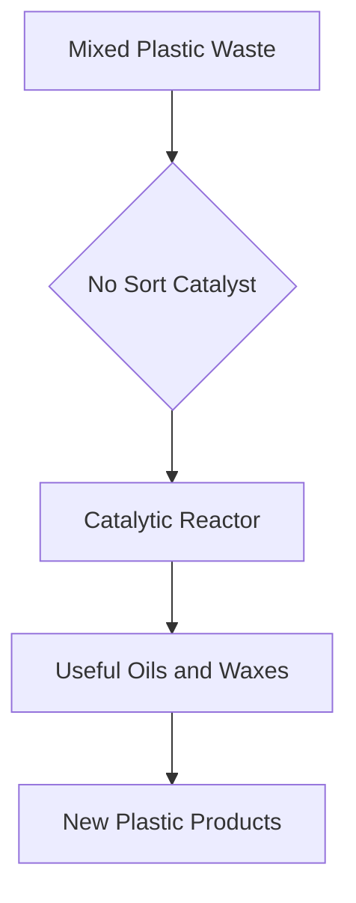

## Chemistry's Cutting Edge: Innovating for a Sustainable Future (October 21, 2026)

As of October 21, 2026, the world of chemistry continues to be a vibrant hub of innovation, tackling some of humanity's most pressing challenges. From revolutionary recycling methods to groundbreaking approaches for carbon utilization and advanced energy storage, chemists are paving the way for a more sustainable future.

One of the most exciting recent developments lies in **plastic recycling**. Traditional methods often struggle with the tedious and costly necessity of sorting plastic waste by type. However, breakthroughs are making "no-sort" plastic recycling a near reality. In September 2025, Northwestern University announced a low-cost, nickel-based catalyst that can selectively and efficiently convert mixed polyolefins – the plastics commonly found in everyday items like milk jugs and plastic wrap – into useful oils and waxes. This innovation could drastically reduce the labor-intensive pre-sorting step, making recycling more practical and economically viable. Complementing this, a team from the University of Texas at Austin and Sandia National Laboratories recently unveiled a new low-waste chemical method in September 2026 for breaking down tough-to-recycle plastics, like poly(dicyclopentadiene) (pDCPD), used in vehicle bumpers and construction equipment. This energy-efficient process allows for the full recovery of valuable fibers, addressing a significant waste challenge.

Beyond plastics, chemists are making substantial strides in **carbon dioxide utilization (CO2U)**. Recognizing CO2 as a potential resource rather than just a waste product, researchers are developing technologies to transform it into valuable chemicals and fuels. "The CO2 Tree" concept, introduced in December 2024, illustrates the vast array of potential products derived from CO2 utilization, highlighting its role in addressing climate change. Ongoing efforts in electroreduction, photocatalysis, and sustainable process design are accelerating the translation of CO2 reduction research into scalable, real-world applications.

The quest for more efficient and sustainable **energy storage** also sees continuous innovation. The global battery energy storage system market is projected for significant growth, driven by advancements in novel battery systems. As of 2026, there's a strong shift towards solid-state batteries, which offer enhanced safety and energy density, and sodium-ion batteries, presenting a cost-effective alternative to lithium-ion technology. Hybrid electrolytes and nano-buffer layers are also critical areas of research, enhancing battery performance and longevity.

These breakthroughs underscore chemistry's dynamic role in fostering environmental responsibility and technological advancement.

