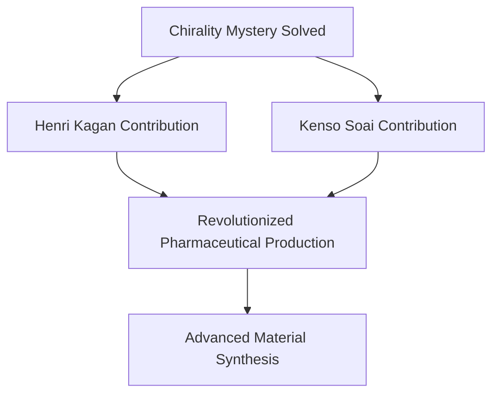

## Chemistry in the Spotlight: Unraveling Molecular Mysteries and Greening Our Future (October 22, 2026)

As of October 22, 2026, the world of chemistry is abuzz with groundbreaking advancements, most notably the recent announcement of the Nobel Prize, alongside a continued surge in sustainable innovations. These developments underscore chemistry's pivotal role in understanding life's complexities and shaping a more sustainable planet.

### The 2026 Nobel Prize in Chemistry: A Century-Old Puzzle Solved

The Royal Swedish Academy of Sciences recently awarded the 2026 Nobel Prize in Chemistry to **Henri B. Kagan** and **Kenso Soai** for their seminal discoveries in "non-linear effects and autocatalysis in asymmetric organic synthesis." Their work has provided a long-sought solution to a century-old mystery: how homochirality, the preference for one mirror-image form of a molecule over another, can spontaneously emerge.

Kagan's pioneering research in 1986 revealed a novel method to manipulate chemical reactions, enabling the creation of a greater excess of one mirror image than previously deemed possible. Building on this, Soai, in 1995 and 2003, achieved the remarkable feat of designing the "Soai reaction," the first chemical reaction in which only one of two potential mirror images was formed – a triumph previously exclusive to nature. These discoveries have profoundly revolutionized the manufacturing of pharmaceuticals, flavors, scents, and new materials, where controlling molecular handedness is crucial for desired effects.

### Green Chemistry: Driving a Sustainable Revolution

Beyond fundamental discoveries, the chemical industry in 2026 is heavily invested in green chemistry, transitioning from a niche concept to a core business strategy. This field is rapidly innovating to minimize environmental impact and improve efficiency across the chemical value chain. Key trends include:

*   **AI-Accelerated Innovation:** Artificial intelligence is proving to be a powerful tool, speeding up the discovery of new molecules and optimizing production processes.
*   **Carbon Dioxide Utilization:** Strategies for capturing and converting CO2 into valuable chemicals are gaining significant momentum.
*   **Bio-Based Chemicals and Renewable Feedstocks:** The shift towards utilizing plant sugars, agricultural waste, and other renewable resources is reshaping supply chains and reducing reliance on fossil fuels.
*   **Sustainable Manufacturing:** Companies are prioritizing energy-efficient processes, waste reduction systems, and water recycling technologies to achieve net-zero objectives.

Recent acknowledgments, such as the 2026 Green Chemistry Challenge Award for a platform enabling the upcycling of polyurethane foams, highlight the tangible progress in creating a circular economy for materials. The "Green Chemistry in America 2026" report further confirms the field's strong contribution to job creation, operational efficiency, and long-term economic growth.

From unraveling life's inherent molecular asymmetries to pioneering environmentally conscious manufacturing, chemistry continues to be a dynamic and essential science, shaping our present and safeguarding our future.