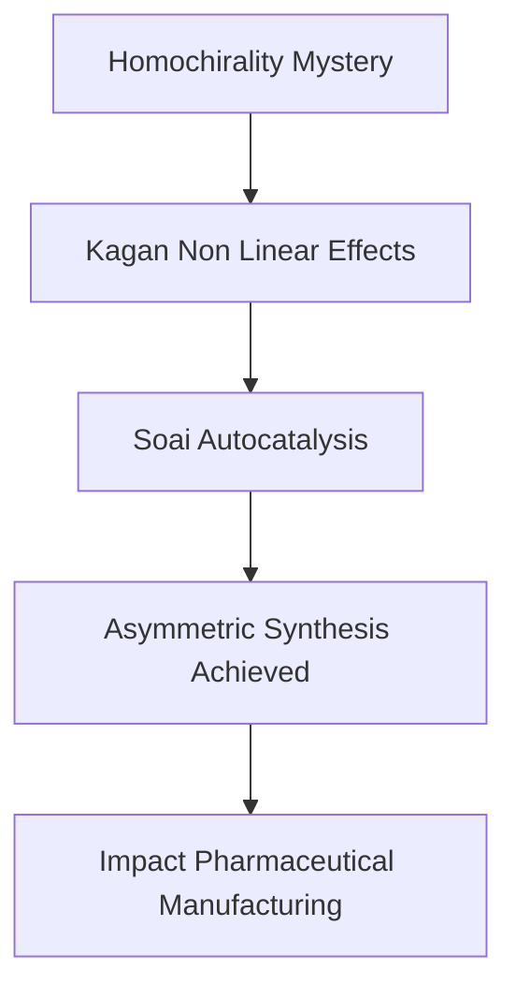

## Chemistry's Latest Triumph: Unraveling Life's "Mirror Image" Mystery – The 2026 Nobel Prize in Chemistry

As of October 24, 2026, the chemistry world is abuzz with the recent announcement of the **2026 Nobel Prize in Chemistry**, awarded to Professors Henri B. Kagan and Kenso Soai. Their groundbreaking work on asymmetric organic synthesis, specifically the discovery of non-linear effects and autocatalysis, has finally provided solutions to the long-standing mystery of homochirality in nature.

Many molecules vital for life, like amino acids, exist in two forms that are mirror images of each other, much like our left and right hands. This property is called chirality. Intriguingly, living organisms almost exclusively utilize only one of these "mirror image" variants, a phenomenon known as homochirality. For decades, chemists struggled to replicate this natural selectivity in the lab, typically producing an equal mix of both forms. This was a significant challenge, especially in pharmaceutical manufacturing, where only one mirror image might have the desired therapeutic effect, while the other could be inactive or even harmful.

Professor Henri Kagan took the decisive first step in 1985 (published in 1986) when he discovered a new way to manipulate chemical reactions, enabling the creation of a greater excess of one mirror image than previously thought possible. Following this, Professor Kenso Soai achieved a monumental breakthrough in 1995. He designed the first chemical reaction in which *only* one of the potential mirror images was formed, a feat previously only observed in nature. This "Soai reaction" is considered one of the most spectacular chemical experiments ever conducted.

Together, Kagan and Soai's discoveries provide a profound understanding of how homochirality can emerge spontaneously and have furnished chemists with powerful new tools for designing asymmetric reactions. This has been revolutionary for the pharmaceutical industry, allowing for the precise manufacturing of drugs where the specific "handedness" of a molecule is crucial for its efficacy and safety. Their work not only sheds light on a fundamental chemical mystery but also paves the way for advanced chemical synthesis with immense practical implications.

Here's a simplified overview of the progression:

