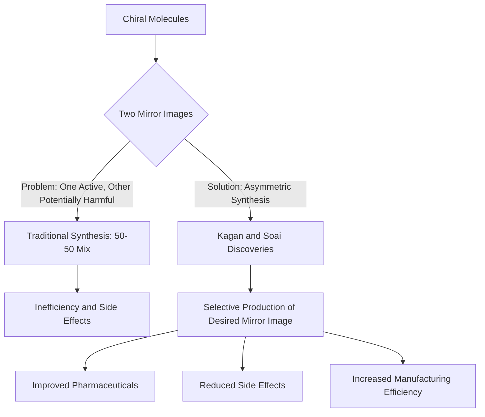

## Chemistry's Latest Triumph: The 2026 Nobel Prize for Chiral Breakthroughs

As of October 30, 2026, the world of chemistry is still buzzing with the announcement of the 2026 Nobel Prize in Chemistry. The Royal Swedish Academy of Sciences has honored Henri B. Kagan and Kenso Soai for their groundbreaking work on non-linear effects and autocatalysis in asymmetric organic synthesis. This pivotal research has provided a solution to the long-standing mystery of how homochirality can emerge spontaneously and is profoundly impacting pharmaceutical manufacturing.

Many molecules, including vital amino acids, exist in two mirror-image forms, much like our left and right hands. These are known as chiral molecules. While one mirror image might offer therapeutic benefits, its counterpart could be ineffective or even harmful. For decades, chemists faced the challenge of producing only the desired mirror image in reactions, often resulting in a 50-50 mix that was inefficient and problematic for drug development.

Kagan and Soai's discoveries have enabled chemists to control these reactions, allowing for the selective production of one mirror-image form. Henri Kagan's work, beginning in 1986, revealed new ways to manipulate chemical reactions to achieve a greater excess of one mirror image. Kenso Soai further advanced this by designing the first chemical reaction that exclusively forms one of the potential mirror images, a feat described as "probably the coolest experiment in organic chemistry."

These breakthroughs are not just academic marvels; they have immense practical implications. The ability to precisely synthesize chiral molecules is crucial for the pharmaceutical industry, where even subtle differences in molecular structure can dictate a drug's efficacy and safety. This work is leading to the development of more effective medicines with fewer side effects, making manufacturing processes more efficient, and reducing waste. Their contributions have reshaped our understanding of molecular chirality and how it can be created and transmitted.

The Nobel Committee for Chemistry highlighted that Kagan and Soai "solved chemistry's asymmetric mystery," a problem that dates back over a century to Louis Pasteur's investigations into tartaric acid. This recognition underscores the profound and lasting impact of their foundational work on modern chemistry and its applications in improving human health.

