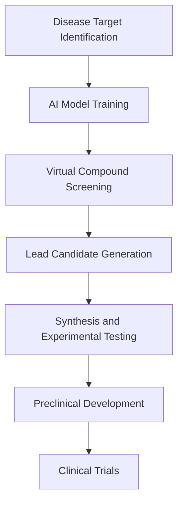

## Chemistry in the Spotlight: October 2026 Sees Nobel Laureates Honored, AI Accelerating Drug Discovery, and a Push for Sustainable Solutions

As of October 31, 2026, the world of chemistry is buzzing with groundbreaking advancements, from prestigious accolades recognizing fundamental discoveries to the rapid integration of artificial intelligence in drug development and a concerted global effort towards sustainable practices.

### 2026 Nobel Prize in Chemistry Celebrates Asymmetric Synthesis

This month, the Royal Swedish Academy of Sciences awarded the 2026 Nobel Prize in Chemistry to Henri B. Kagan and Kenso Soai "for the discovery of non-linear effects and autocatalysis in asymmetric organic synthesis". Their pioneering work has demystified how homochirality, where only one of two mirror-image molecular variants is present, can emerge spontaneously in chemical reactions. This discovery is profoundly significant, particularly for pharmaceutical manufacturing, where synthesizing only the desired mirror-image molecule is crucial for drug efficacy and safety. Kagan's initial decisive step in 1986 involved a novel method to manipulate chemical reactions, leading to a greater excess of one mirror image than previously thought possible, while Soai's breakthroughs in 1995 and 2003 led to the first homochiral chemical reaction, a feat previously only observed in living organisms.

### AI Continues to Revolutionize Drug Discovery

The application of artificial intelligence in drug discovery and development has reached a new fervor in October 2026. Major partnerships and significant investments are accelerating the identification of new drug targets and candidates. AstraZeneca, for instance, has partnered with insitro in a deal potentially worth $1.5 billion to leverage AI for discovering drug targets for liver and heart conditions. Companies like Iambic are making headlines with successful IPOs, underscoring investor confidence in AI-driven approaches to disrupt traditional drug discovery paradigms.

The field is moving beyond isolated digital tools to fully integrated, AI-native discovery systems, with "lab-in-the-loop" systems becoming a critical focus. Danaher and NVIDIA have joined forces to develop autonomous AI-powered laboratories, aiming to accelerate the journey from prediction to experimental evidence. Such advancements mean that the bottleneck in drug discovery is shifting from computational modeling to the efficiency of laboratory experimentation, driving a continuous learning cycle where experiments inform AI models and vice-versa. Predictive models, particularly for protein structure prediction and docking, are already showing significant impact in speeding up time-to-target and improving hit rates.

### Sustainable Chemistry Gains Momentum

The drive towards a greener future is heavily influencing chemical research and industrial practices. Sustainable catalysis is a rapidly advancing multidisciplinary field focused on developing catalysts that improve reaction efficiency and selectivity while minimizing environmental impact. Recent advances in sustainable catalysis are enabling environmentally friendly synthesis strategies, the valorization of waste into high-value products, and the use of waste-derived materials. Innovations in advanced materials design, including covalent organic frameworks (COFs) and metal-organic frameworks (MOFs), are central to these sustainable processes.

Furthermore, artificial intelligence is playing a crucial role in carbon dioxide utilization, helping uncover thousands of chemical reactions to transform CO2 into fuels and chemicals. This concerted effort underscores a global commitment to reducing carbon footprints and fostering circular carbon economies, utilizing renewable feedstocks like biomass and plastic waste.

Here's a look at the AI-driven drug discovery process:

The landscape of chemistry in October 2026 is one of profound innovation, driven by a blend of foundational scientific inquiry, cutting-edge technological integration, and an unwavering commitment to global sustainability.