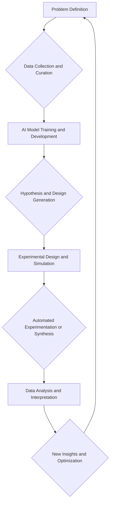

## Chemistry's New Frontier: AI Accelerates Discovery in 2026

As of November 2, 2026, the landscape of chemistry is being reshaped at an unprecedented pace, largely thanks to the transformative power of Artificial Intelligence (AI). What was once a specialized topic is now a core research capability, influencing nearly every stage of the scientific process. From designing novel molecules to optimizing complex reactions and accelerating drug development, AI is proving to be chemistry's indispensable new lab mate.

In drug discovery, AI is revolutionizing the timeline from concept to clinic. Machine learning algorithms analyze vast datasets to accurately predict molecular behavior, screen millions of virtual compounds, and identify promising drug candidates with remarkable speed. This integration shortens development timelines, reduces inherent risk, and enables the targeting of previously "undruggable" targets. Researchers are seeing AI platforms rapidly identify candidates even before wet-lab experiments begin, making the process more efficient and cost-effective. We are also witnessing AI-driven design helping create therapeutics that can cross the blood-brain barrier and the first AI-designed molecules entering Phase III clinical trials.

Beyond pharmaceuticals, AI is making significant inroads into materials innovation, helping researchers design materials with specific properties for applications ranging from advanced batteries to sustainable catalysts. The optimization of industrial processes through AI also shows immediate value in improving yields, reducing waste, and enhancing safety in chemical manufacturing. The concept of "self-driving laboratories" is moving from theoretical to practical, where AI designs experiments, automation performs them, and the system continuously learns from new data in a closed-loop system.

Sustainable chemistry, a critical area for addressing global challenges, is also benefiting immensely. AI assists in green synthesis pathways, carbon capture and utilization technologies, and the development of biodegradable alternatives to conventional plastics. For instance, AI has been used to uncover nearly 10,000 chemical reactions involved in transforming carbon dioxide into fuels and chemicals, revealing crucial pathways previously missed by traditional models.

The consensus across the scientific community is clear: AI in chemistry is no longer a question of "if," but "how" to use it effectively and responsibly. Human intelligence remains crucial, particularly for expert review and validating AI-generated results, ensuring scientific rigor and ethical application.

