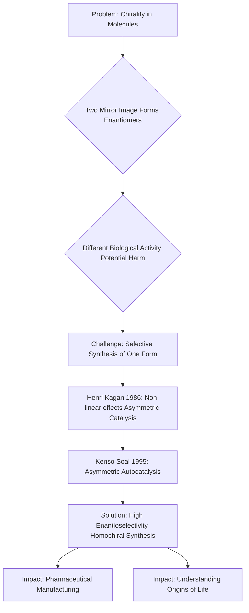

## Chemistry's Guiding Hands: Nobel Laureates Kagan and Soai Unravel Mirror-Image Mysteries

As of November 3, 2026, the scientific community is still buzzing with the announcement of the 2026 Nobel Prize in Chemistry, awarded to Professors Henri B. Kagan and Kenso Soai. The Royal Swedish Academy of Sciences recognized their groundbreaking work on "non-linear effects and autocatalysis in asymmetric organic synthesis". Their discoveries have revolutionized how chemists create molecules with specific "handedness," a concept crucial for everything from pharmaceuticals to understanding the origins of life itself.

Many molecules exist as mirror images of each other, much like our left and right hands. These "chiral" molecules, despite having the same chemical formula, can interact very differently with biological systems. For instance, one mirror image of a drug might be therapeutic, while its counterpart could be ineffective or even harmful. A historic example is thalidomide, where one enantiomer treated morning sickness, but its mirror image caused severe birth defects. For over a century, chemists faced the challenge of selectively synthesizing just one of these mirror images in the lab.

Henri Kagan took a decisive step in 1986, discovering "non-linear effects" in asymmetric catalysis. He showed that a small imbalance in a chiral catalyst could lead to a much larger excess of one mirror-image product, making it possible to manipulate reactions to favor a desired enantiomer.

Kenso Soai pushed this frontier further. In 1995, he designed the first chemical reaction where a molecule could catalyze its own formation in a specific mirror-image form, a process known as asymmetric autocatalysis. By 2003, he achieved a spectacular feat: a reaction that produced only one of the two possible mirror images, a level of selectivity previously only observed in living systems. This "Soai reaction" offered a laboratory model for how homochirality – the preference for one mirror image in biological molecules like amino acids – might have emerged spontaneously in nature.

The impact of Kagan and Soai's work is profound. Their discoveries are fundamental to the efficient and safe production of pharmaceuticals, flavors, and scents, ensuring that only the desired and effective molecular form is produced. Beyond practical applications, their insights continue to inspire research into the fundamental question of how life became "left-handed" or "right-handed" at a molecular level.

