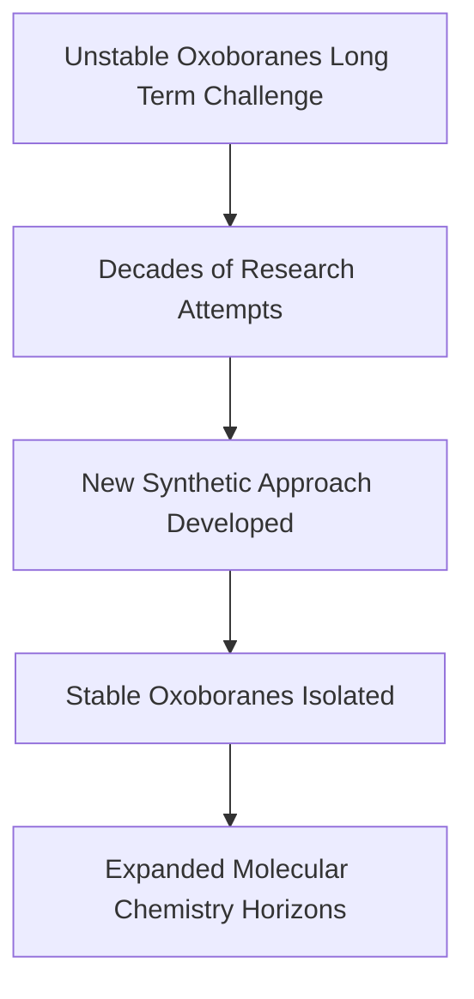

**Chemistry Unlocks 60-Year Mystery: Stable Oxoboranes Finally Isolated**

As of November 7, 2026, the world of fundamental chemistry is abuzz with news of a significant breakthrough: the successful isolation of stable oxoboranes. For over six decades, these elusive boron-oxygen molecules were considered too unstable for ordinary laboratory study, presenting a formidable challenge to researchers. Now, scientists at the University of Würzburg in Germany, led by Professor Holger Braunschweig, have achieved what was long thought impossible, opening new avenues in molecular chemistry.

Boron is an element known for its unique bonding characteristics, often forming unusual connections. However, creating stable molecules containing triple bonds involving boron, particularly with oxygen, has been a persistent hurdle. Previous milestones by Braunschweig's team included the first molecule with a triple bond between two boron atoms in 2012, and a neutral molecule featuring a boron-carbon triple bond in 2025. The isolation of stable oxoboranes marks another triumph in this challenging field.

This surprising discovery was achieved using relatively simple chemical reactions, a testament to ingenious synthetic methodology. The ability to produce and isolate these compounds paves the way for exploring an entirely new class of exotic compounds. This breakthrough not only resolves a long-standing mystery but also promises to deepen our understanding of chemical bonding and reactivity, potentially leading to unforeseen applications in various fields.

The isolation of stable oxoboranes underscores the enduring power of fundamental research to push the boundaries of knowledge and reveal the hidden complexities and possibilities within the chemical elements.

