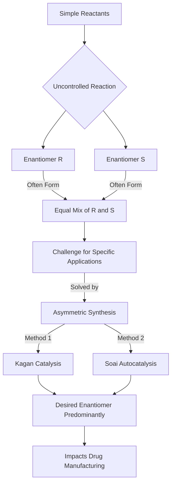

## Nobel Laureates Unravel Chemistry's Mirror Image Mystery, Revolutionizing Drug Design

**November 8, 2026** – The scientific world celebrates a profound achievement as Henri Kagan and Kenso Soai are honored with the 2026 Nobel Prize in Chemistry. Their groundbreaking work on "mirror image" molecules, also known as chiral molecules, has provided fundamental insights into how these elusive forms are created and controlled, with immense implications for fields ranging from pharmaceuticals to the very origins of life.

Many molecules exist in two forms that are non-superimposable mirror images of each other, much like a person's left and right hands. These "enantiomers" can have vastly different properties, even though their chemical formulas are identical. A classic example is found in pharmaceuticals, where one enantiomer of a drug might be therapeutic, while its mirror image could be ineffective or even harmful. For decades, chemists faced the formidable challenge of selectively synthesizing only the desired enantiomer.

Henri Kagan pioneered the field of asymmetric catalysis in the 1970s. He developed methods using chiral catalysts to guide chemical reactions to preferentially produce one enantiomer over the other. His discoveries provided chemists with a crucial tool to manipulate chemical reactions with unprecedented precision, enabling the production of a greater excess of one mirror image than previously thought possible.

Later, Kenso Soai made a remarkable breakthrough with the "Soai reaction." He designed the first chemical reaction where only one of the potential mirror images was formed, even when starting with achiral reactants or a minute imbalance of one enantiomer. This phenomenon, known as autocatalysis, allows a molecule to act as a catalyst for its own formation, dramatically amplifying the production of a single enantiomer and almost eliminating its mirror counterpart from the final product.

The collective contributions of Kagan and Soai have reshaped our understanding of molecular chirality and how it can be controlled. Their work has provided chemists with fundamental new tools for their daily work, critically impacting the manufacturing of pharmaceuticals, flavors, scents, and new materials. Moreover, their discoveries shed light on one of chemistry's greatest mysteries: how homochirality – the exclusive presence of one mirror-image form in all living organisms – could have emerged in the natural world.

This Nobel Prize recognizes decades of persistent inquiry and ingenious solutions that have opened new avenues for chemical synthesis and deepened our understanding of life's molecular foundations.

