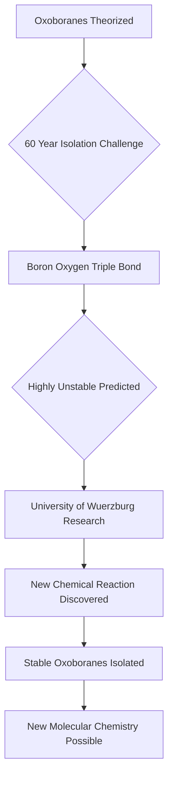

## Chemistry's 60-Year Mystery Unraveled: Stable Oxoboranes Finally Isolated

In a significant breakthrough that resolves a six-decade-long challenge in chemistry, scientists at the University of Würzburg in Germany have successfully produced and isolated stable oxoboranes. These elusive molecules, characterized by a unique triple bond between boron and oxygen, were previously considered too unstable for ordinary laboratory study.

For over 60 years, chemists around the world had attempted to capture these reactive compounds, which are part of the p-block elements in the first row of the periodic table. Boron, in particular, rarely forms triple bonds, making the stabilization of oxoboranes a persistent hurdle. The team, led by Professor Holger Braunschweig, along with computational support from Professor Ashwini K. Phukan's group at Tezpur University in India, discovered a surprisingly straightforward method to create these compounds.

The unexpected discovery emerged when doctoral students Lukas Lubczyk and Christian Markl reacted a diboracumulene compound with different ketones, yielding unusual orange or yellow solids that turned out to be the long-sought oxoboranes. This breakthrough not only provides a new path to a previously inaccessible class of exotic compounds but also demonstrates how unexpected reactions can unlock possibilities once thought beyond reach. The successful isolation of three different oxoboranes suggests the potential for a much wider range of these molecules, opening new avenues for research in molecular chemistry and potentially leading to the development of novel materials.

The discovery, published in *Nature Chemistry*, marks a pivotal moment, showcasing that even long-standing chemical mysteries can be solved through persistent investigation and a touch of serendipity.

