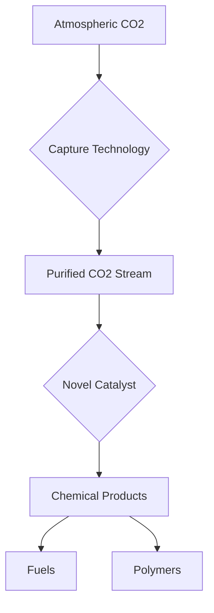

Today, November 15, 2026, the world of chemistry continues to buzz with groundbreaking developments, particularly in the realm of sustainable solutions. A key area drawing significant attention is the relentless pursuit of efficient **Carbon Capture and Utilization (CCU)** technologies, specifically through the design of novel catalytic materials. Recent advancements are rapidly transforming how we view carbon dioxide, from a detrimental greenhouse gas to a valuable chemical feedstock.

Scientists are making remarkable strides in engineering highly selective and robust catalysts that can convert CO2 into a diverse array of useful products, including fuels, polymers, and other industrial chemicals. These catalysts, often based on advanced nanomaterials, metal-organic frameworks (MOFs), or specially designed enzyme mimetics, are crucial for lowering the energy input required for CO2 reduction and increasing the yield of desired products. The focus is not just on capture, but on the *valorization* of captured carbon, creating a circular economy model.

Ongoing research is tackling challenges such as catalyst stability, longevity, and scalability for industrial applications. These innovations represent a critical step towards mitigating climate change while simultaneously fostering new industries and reducing reliance on fossil resources. The integration of artificial intelligence and machine learning is also accelerating catalyst discovery, predicting optimal material compositions and reaction pathways with unprecedented speed. This synergistic approach promises even faster progress in the years to come, painting a hopeful picture for a more sustainable chemical future.

