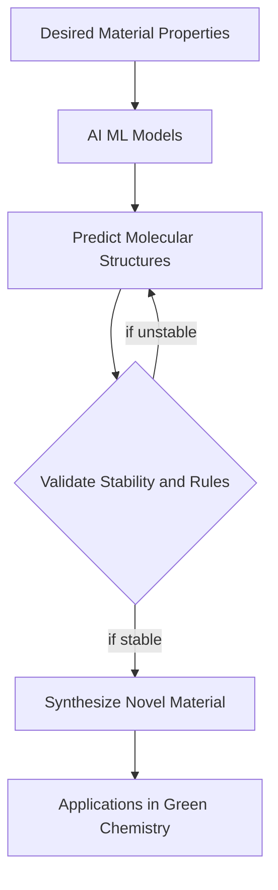

## Chemistry's Cutting Edge: Designing Tomorrow's Materials, Sustainably

November 17, 2026 – The world of chemistry is buzzing with transformative developments this November, showcasing a relentless drive towards innovation and sustainability. From reimagining fundamental material structures to leveraging artificial intelligence for smarter design, the chemical sciences are charting a course for a more efficient and environmentally conscious future.

Just last week, scientists at MIT made headlines by challenging long-held principles in materials science. They discovered that employing flexible molecular connections, rather than rigid ones, can unlock entirely new ways to arrange nanoparticles into crystal structures never before observed. This groundbreaking work, published on November 4, 2026, could pave the way for a new generation of designer materials with unprecedented properties, finding applications in diverse fields such as advanced electronics, targeted medicine, and energy technologies.

This breakthrough aligns with a broader trend in the industry: the accelerating role of artificial intelligence (AI) in material discovery. AI and machine learning models are dramatically speeding up the design process by predicting material properties and even proposing novel molecular structures that human chemists might not conceive. More recently, MIT researchers have introduced a new framework called CrysVCD, which integrates chemical rules into the initial stages of AI-driven design. This innovative approach ensures the chemical stability of proposed materials from the outset, significantly reducing the computational cost and time traditionally associated with validating new material designs. Such advancements are democratizing access to cutting-edge materials research, allowing even smaller labs to pursue ambitious design goals.

Further emphasizing chemistry's commitment to global challenges, the Gordon and Betty Moore Foundation announced on November 16, 2026, the establishment of four Integrated Research Hubs dedicated to exploring new frontiers in chemical design. These hubs, part of an expanded Green Chemistry Initiative, aim to transform how chemicals and materials are conceived, with a core focus on embedding safety and sustainability from the very beginning. One such hub, led by The George Washington University, will combine AI and quantum chemistry to achieve safer molecular designs, highlighting a synergistic approach to address human health and environmental protection.

These concurrent developments underscore a pivotal moment in chemistry. We are witnessing not just individual discoveries, but a systemic shift towards intelligent, sustainable, and fundamentally new ways of creating the materials that will define our future.

