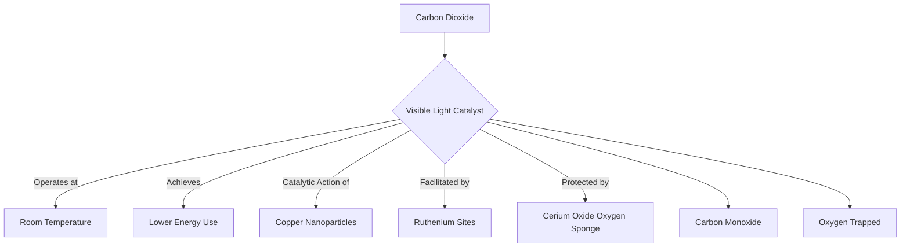

## Green Chemistry Shines: Carbon Dioxide Transformed with Visible Light

**November 22, 2026** – In a significant leap for sustainable chemistry, researchers at Rice University have unveiled a groundbreaking method to convert carbon dioxide (CO2) into valuable industrial raw materials using only visible light at room temperature. This innovation, published just days ago, tackles a long-standing challenge in chemical manufacturing by dramatically reducing the energy input required for CO2 conversion.

Traditionally, splitting stable CO2 molecules demands extreme industrial temperatures, often ranging from 700 to 1,500 degrees Celsius, or intense electrical discharges. These conventional processes are notoriously energy-intensive and can themselves generate further carbon emissions. The Rice University team's breakthrough offers a far more energy-efficient pathway, opening new avenues for recycling greenhouse gas emissions into useful compounds like carbon monoxide. Carbon monoxide is a crucial building block for synthetic fuels, plastics, and various industrial chemicals.

The novel catalyst system employs copper nanoparticles, which act as microscopic antennas to channel high-energy electrons when illuminated by visible light. These electrons are then directed to ruthenium reaction sites, initiating the breakdown of CO2 into carbon monoxide and oxygen. A key element of this system is cerium oxide, which functions as an "oxygen sponge," temporarily trapping the freed oxygen atoms and preventing them from recombining with carbon monoxide or degrading the catalyst. This ingenious design allows for easy regeneration of the catalyst with nitrogen gas for continuous operation.

This development promises to enable chemical manufacturers and industrial facilities to move closer to net-zero production by cost-effectively converting underutilized industrial emissions into valuable chemical feedstocks.

