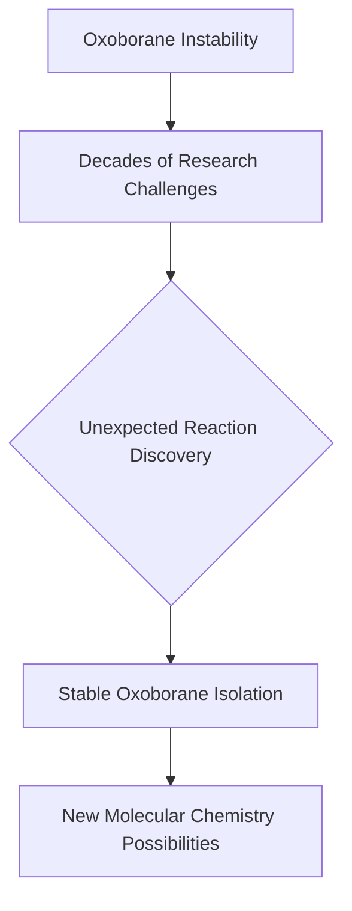

## 60-Year Chemistry Mystery Solved: Scientists Capture Elusive Oxoboranes

Chemistry enthusiasts, rejoice! A decades-old puzzle in the world of molecular chemistry has finally been cracked. After more than 60 years of unsuccessful attempts, scientists at the University of Würzburg in Germany have achieved the remarkable feat of producing and isolating stable oxoboranes. This breakthrough, published recently in Nature Chemistry, is poised to open entirely new avenues in fundamental molecular chemistry.

Oxoboranes are a class of boron-oxygen molecules that feature an unusual triple bond, a configuration long considered too unstable to be captured and studied under ordinary laboratory conditions. For generations, researchers grappled with the ephemeral nature of these compounds, which would decompose almost immediately upon formation. The inability to isolate them meant that their unique properties and potential applications remained largely a mystery.

The pivotal discovery emerged from experiments led by Professor Holger Braunschweig and his team, with computational support from researchers at Tezpur University in India. In what was described as an "unexpected reaction," two doctoral students independently observed the formation of distinctive orange or yellow solids—the elusive oxoboranes, now stable enough for detailed analysis.

This groundbreaking achievement not only resolves a persistent challenge but also demonstrates a surprisingly straightforward method to create these previously unattainable compounds. The successful preparation of three different oxoboranes suggests that this novel approach could unlock access to a much wider array of similar molecules. The implications are profound, potentially paving the way for the creation of an entirely new class of exotic compounds and expanding our understanding of bonding involving elements across the periodic table.

