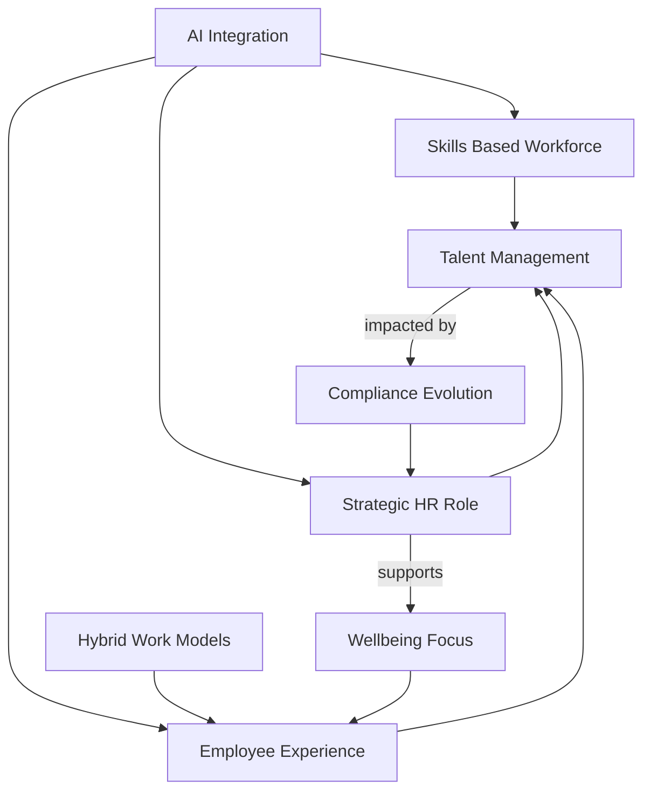

## HR Navigates a Dynamic 2026: AI, Skills, and Experience Take Center Stage

As of October 2026, the HR landscape is characterized by rapid transformation, driven primarily by the accelerating integration of Artificial Intelligence, a strategic pivot to skills-based work, and an unyielding focus on the employee experience. HR leaders are no longer just supporting business objectives; they are actively shaping them, acting as strategic partners, data interpreters, and change facilitators.

Artificial Intelligence (AI) is arguably the most impactful trend, moving from experimentation to operationalization within HR functions. While 92% of CHROs anticipate greater AI integration, a significant "value gap" exists, with many HR teams yet to see substantial business value from these tools. The focus is now on agentic AI, which can independently plan and adapt, transforming tasks and job roles. HR's challenge is to blend technological advancement with fairness, trust, and human judgment, especially as regulations like the EU AI Act classify employment-related AI systems as high-risk.

Alongside AI, the shift towards a skills-based workforce is critical. Organizations are increasingly assessing skills inventories to reshape job design, hiring, development, and strategic workforce planning. This approach helps address persistent skills gaps and aligns people strategies with business goals, emphasizing capabilities over traditional headcount scaling.

Employee experience (EX) and well-being remain paramount. Flexible and hybrid work models have become standard, with companies embracing adaptable work locations and timings to boost employee satisfaction and business results. Personalization, holistic well-being support, and addressing the "manager crisis" are key to enhancing engagement and retention. Organizations are recognizing that strong employee well-being functions as organizational infrastructure, impacting performance and resilience.

The complex interplay of these trends also highlights ongoing challenges in talent acquisition and retention in competitive markets, requiring a re-evaluation of the entire employee value proposition. Furthermore, HR must navigate an evolving legal landscape, with constant vigilance required for changes in employment law, GDPR, and emerging legislation around AI in recruitment, including potential impacts from Supreme Court decisions.

Here's a look at the interconnected HR trends:

