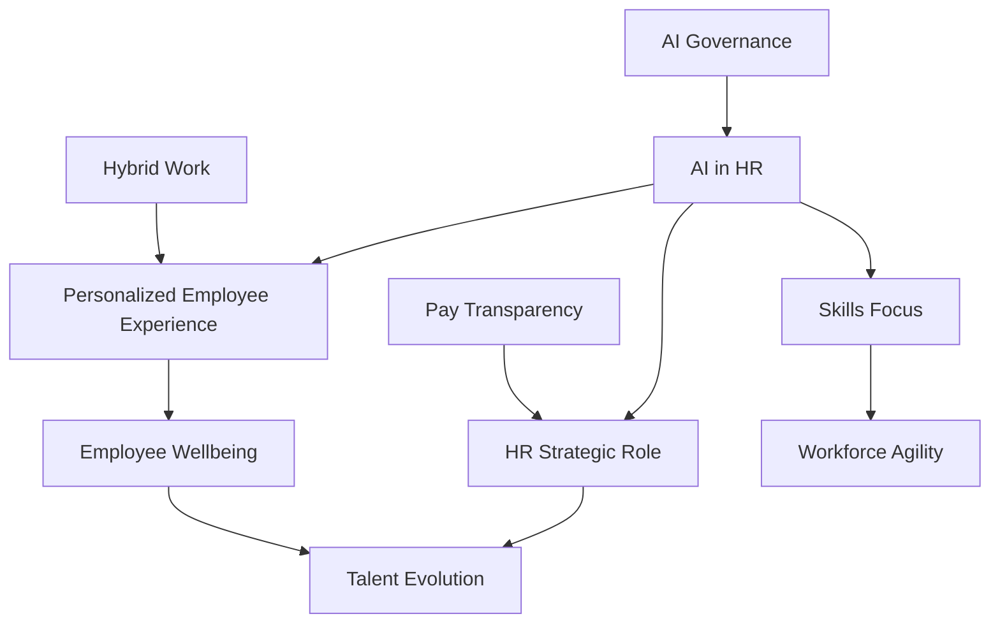

## HR Navigates the Human-AI Era: Key Trends for October 2026

As of October 2026, the Human Resources landscape is experiencing a profound transformation, driven largely by rapid technological advancements and evolving employee expectations. HR is firmly stepping into a strategic operational role, guiding organizations through continuous change and fostering a human-centric approach in an increasingly AI-powered world.

### AI's Operational Takeover in HR

Artificial Intelligence, particularly "agentic AI" (AI systems that can execute multi-step tasks and adapt to achieve goals), is moving beyond experimental phases to become fully operational across HR functions. Organizations are leveraging AI to automate workflows, optimize tasks, and generate insights in areas like talent acquisition, personalized learning, and employee experience. However, the focus remains strongly on human-centered AI, emphasizing robust governance and ethical considerations to ensure fair and unbiased decision-making, especially in employment. The true impact of AI in HR is seen when it's deeply embedded into workflows and operating models, delivering measurable business value rather than just individual efficiency gains.

### The Rise of Skills-Based Everything

The shift to a skills-based economy is accelerating, fundamentally reshaping how companies hire, develop, and deploy talent. Employers are increasingly prioritizing practical skills, competencies, and real-world experience over traditional academic credentials. This approach not only expands talent pools significantly but also drives internal mobility and personalized career development through internal talent marketplaces and AI-powered learning platforms. Research indicates that skills-based hiring is up to five times more predictive of job performance than education alone.

### Wellbeing as Core Organizational Infrastructure

Employee wellbeing has evolved from a standalone program to a critical component of organizational infrastructure. Companies are integrating physical, mental, and financial wellbeing into their work design, leadership practices, and performance management systems. Burnout is recognized as a board-level risk, necessitating proactive prevention strategies. Employees are seeking holistic, preventive wellness programs and personalized benefits that support their mental and physical health. This integrated approach is linked to higher productivity and reduced burnout.

### Personalized Employee Experience (EX)

Driven by AI and continuous feedback, the employee experience is becoming hyper-personalized. Digital workplaces are adapting to individual preferences, work patterns, and needs, providing tailored insights and tools. This focus on personalization aims to eliminate friction in daily work, enhance engagement, and ultimately act as a multiplier for performance, retention, and trust.

### HR's Elevated Strategic Role

HR is no longer just a support function; it's a strategic operator guiding organizations through unprecedented change. This involves balancing human needs with business resilience, navigating high change velocity, and shaping organizational culture to drive performance. Strong collaboration between HR and IT is also becoming crucial due to the complexity of AI-driven technologies.

The current HR landscape is dynamic, demanding agility, ethical innovation, and a steadfast commitment to people-centric strategies.

