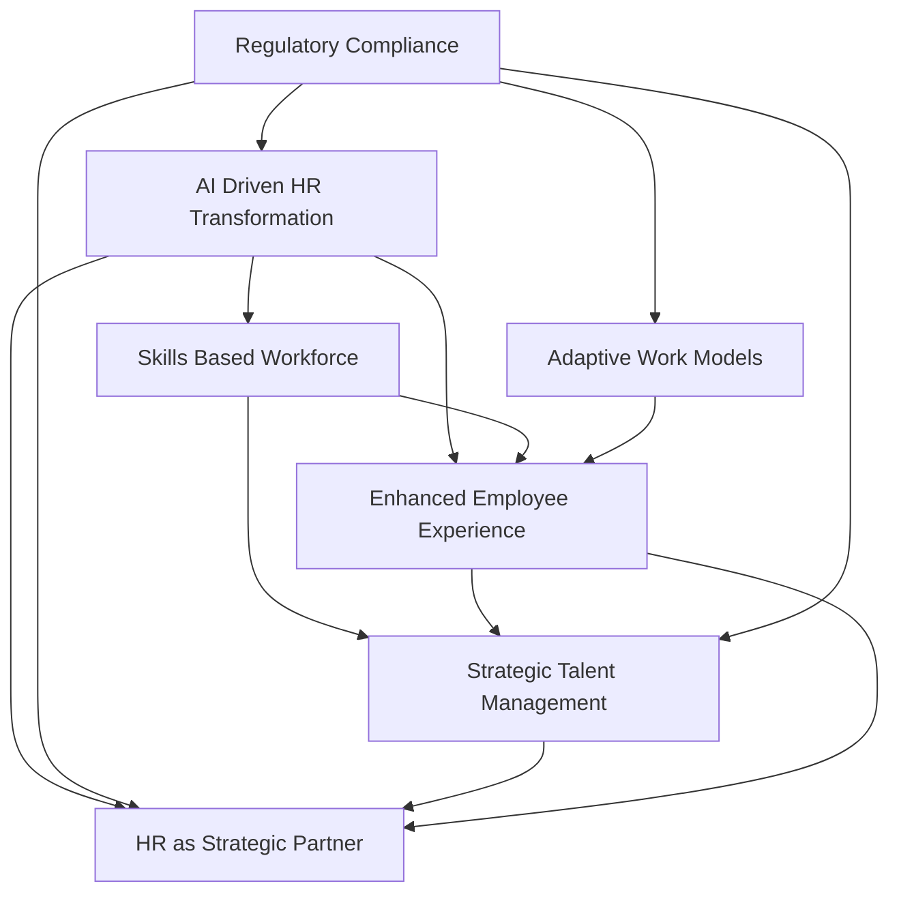

## HR's Evolving Pulse: Live Trends Shaping October 2026

As October 2026 unfolds, the Human Resources landscape is buzzing with rapid evolution, driven by technological advancements and shifting workforce expectations. HR leaders are navigating a complex environment where agility and strategic foresight are paramount. Here's a concise look at the actual live news in HR trends.

**AI's Ascendancy and Agentic Transformation**
Artificial Intelligence is no longer just a buzzword; it's a foundational element reshaping HR operations. In 2026, we are seeing the rise of "agentic AI" and "superagents" that are capable of running end-to-end HR workflows, from recruitment to performance management. This isn't just automation; it's a fundamental redesign of how HR work is executed, leading to streamlined operations and freeing HR professionals for more strategic tasks. Organizations are increasingly focused on integrating AI to enhance decision-making, personalize employee journeys, and achieve enterprise-wide value, though many are still developing clear implementation roadmaps. The close collaboration between HR and IT is becoming critical to manage the complexity and ethical considerations of AI deployment.

**The Shift to Skills-Based Organizations**
The traditional focus on job titles is rapidly giving way to a skills-based approach. As technology evolves at breakneck speed, companies are prioritizing skills over rigid roles to build adaptable and resilient workforces. HR teams are actively creating skills inventories, developing scalable skills frameworks, and designing skill-based career pathways to attract, retain, and develop talent effectively. This paradigm shift is essential for strategic workforce planning and ensuring the right capabilities are in place to meet future business demands.

**Holistic Employee Experience and Well-being at the Forefront**
Employee experience in 2026 encompasses a holistic view of how individuals interact with their workplace across technology, culture, and processes. Well-being and mental health remain top priorities, with employee expectations continually rising. HR is tasked with fostering engaging environments, managing hybrid and remote work models effectively, and creating personalized experiences that boost motivation and retention. The challenge of talent acquisition and retention in a competitive market means HR must rethink the entire employee value proposition, including compensation, benefits, and career growth opportunities.

**Regulatory Compliance and HR's Strategic Imperative**
Navigating the evolving landscape of employment laws, particularly around pay transparency and the ethical use of AI in employment decisions, presents a significant challenge for HR. Compliance is no longer a background function but actively shapes trust and culture within an organization. Ultimately, these dynamic trends underscore HR's increasingly strategic role. HR leaders are expected to be forward-thinking, data-informed, and pivotal in aligning people strategy with broader business objectives, driving resilience and growth.

