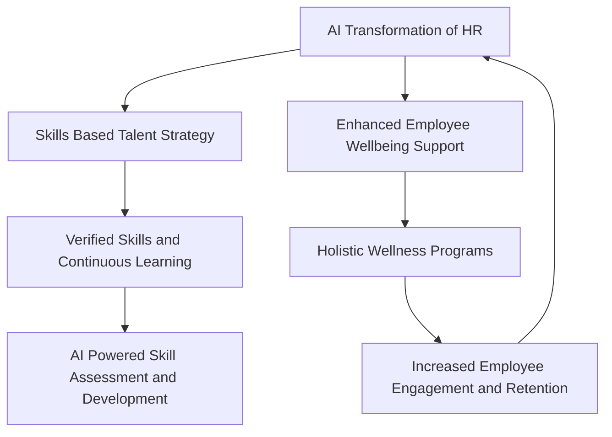

## HR Hits the Headlines: Your Late 2026 Trend Report

As October 2026 draws to a close, the world of Human Resources is buzzing with actual, actionable changes, not just predictions. The strategic imperatives for HR leaders are clearer than ever, shaped by technological acceleration, evolving talent expectations, and a deepening focus on the human element. Here's a concise look at the live news defining HR trends right now.

### The AI Evolution: From Tools to Superagents

Artificial Intelligence is no longer a "future of work" talking point; it's actively reshaping HR functions. In 2026, we're seeing the rise of AI "superagents" that can automate end-to-end HR workflows, from recruiting and coaching to workforce management. This means hundreds of traditional HR processes are being streamlined, cutting routine transactional work and allowing HR professionals to focus on strategic initiatives. Major platforms like Workday, SAP Joule, and Microsoft Copilot are embedding these capabilities directly into HR systems, accelerating adoption.

However, adoption isn't uniform. While 92% of Chief Human Resources Officers (CHROs) expect more AI integration, over half of organizations haven't adopted any form of AI in HR and have no immediate plans for 2026. For those that are, AI is most commonly used in recruiting (27%), HR technology management (21%), and learning and development (17%). This indicates a gap between executive anticipation and frontline implementation, emphasizing the need for structured and governed AI deployment to manage risks like algorithmic bias.

### Skills-Based Hiring Goes Mainstream

The shift from degree-based hiring to a skills-first approach has officially crossed the chasm, becoming the operating model for many organizations. As of late 2026, 81% of employers report using skills-based hiring, and 70% of employers now use these practices. This isn't just about removing degree requirements; it's a fundamental re-architecture of how candidates are evaluated, screened, and offered roles.

A key development is the demand for **verified evidence** to replace self-reported skills, with employers prioritizing scenario-based assessments, issued credentials, and reviewed projects over simple skill lists. This means candidates are now focusing on continuously re-verifying high-impact skills, with some employers refusing to consider verifications older than 18 months for technical roles. AI is also making specialized skills more valuable, driving demand for expertise in areas like cybersecurity, governance, and data quality.

### Holistic Employee Wellbeing Takes Center Stage

Employee well-being remains a top HR priority, but its scope is expanding significantly. The conversation around mental health is evolving toward "mental fitness," focusing on building resilience and emotional strength proactively. Employers are offering mental health coaching, dedicated mental fitness days, and enhanced employee assistance programs.

Beyond mental health, financial well-being is a critical pillar, with economic uncertainty pushing it to the forefront. More employers are offering support to help employees build financial resilience. Furthermore, women's health is reshaping workplace wellness, leading to increased support for fertility benefits, maternity, menstrual, and menopause care. Organizations are moving from standalone programs to embedding wellbeing into their enterprise infrastructure, recognizing its impact on productivity and burnout reduction.

These trends highlight a dynamic HR landscape where technology, talent strategy, and human-centric support are converging to redefine the future of work.

