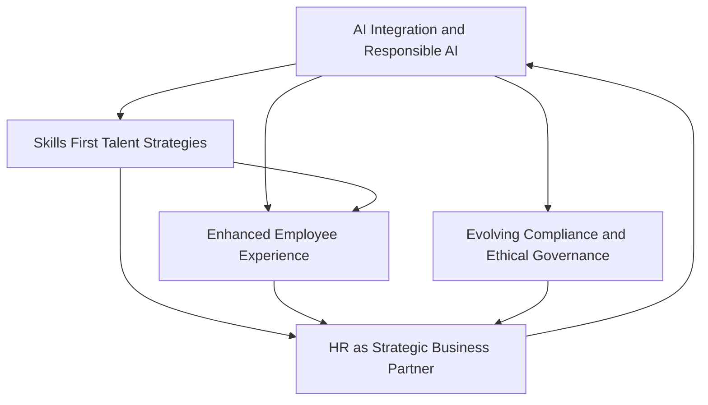

## Navigating Tomorrow: Live HR Trends for Late 2026

As November 2026 unfolds, the human resources landscape continues its rapid evolution, driven by technological advancements, shifting workforce expectations, and a heightened focus on strategic impact. HR leaders are currently balancing innovation with compliance, aiming to cultivate resilient and future-ready workplaces.

A primary force shaping HR is the deep **integration of Artificial Intelligence (AI)**, moving beyond simple features to become a foundational layer across human capital management (HCM) and daily workflows. This "agentic AI" is transforming recruiting, employee experience, and HR operations by automating tasks and enhancing decision-making. Simultaneously, there's an increasing emphasis on **responsible AI adoption and robust governance** to navigate emerging regulations and ethical considerations.

Complementing this technological shift is a strong move towards **skills-first talent strategies**. Organizations are proactively assessing their skills inventories and prioritizing continuous upskilling and reskilling initiatives. Strategic workforce planning is becoming more cross-functional, aligning talent development directly with evolving business goals to address capability mismatches.

The **employee experience (EX)** remains central, evolving to be more personalized and often augmented by AI-powered tools. This includes providing tailored support for well-being, fostering engaging work environments, and offering flexible work arrangements that cater to individual preferences. The goal is to create workplaces where employees genuinely want to thrive.

Consequently, HR is cementing its role as a **strategic business partner**. This transformation demands that HR professionals possess greater digital agility, data literacy, and business acumen to influence critical organizational decisions. It also necessitates tighter collaboration between HR and IT functions as complex, AI-driven technologies become integral to people management.

Finally, **evolving compliance and ethical governance** are top-of-mind. Expanding pay transparency requirements, new paid and unpaid leave mandates, and increasingly stringent regulations around the use of AI in employment decisions are creating complex challenges. HR teams must develop actionable strategies to ensure compliance while upholding ethical standards.

The interconnectedness of these trends underscores a pivotal moment for HR, requiring adaptability, strategic foresight, and a continued commitment to human-centric practices in an increasingly automated world.

