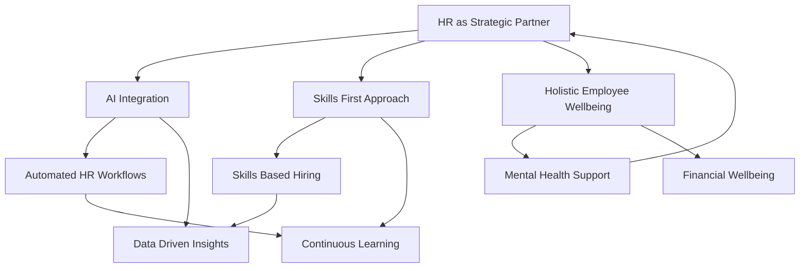

## HR: Navigating the Human-AI Era in Late 2026

As of November 2026, Human Resources is firmly positioned at the intersection of technological advancement and evolving human needs. The function is rapidly transforming from a support role to a strategic partner, guiding organizations through unprecedented change. Here’s a look at the actual live trends reshaping HR today.

### AI Integration: From Experiment to Operational Reality

Artificial Intelligence is no longer a futuristic concept but an operational reality embedded across HR functions. Organizations are moving beyond experimental AI projects to fully operationalizing AI for automating routine tasks like recruiting, learning and development, and administrative workflows. This shift is freeing HR professionals to focus on higher-value, strategic work. However, this also necessitates a focus on responsible AI adoption, emphasizing human-AI collaboration and upskilling for new, AI-enabled roles. Leading HR platforms like Workday, SAP Joule, and Microsoft Copilot are actively embedding AI capabilities, accelerating its impact and adoption.

### The Skills-First Revolution

A significant paradigm shift is underway in talent acquisition and development: the move towards skills-based hiring. Employers are increasingly prioritizing practical skills, competencies, and real-world experience over traditional academic degrees. In fact, approximately 70% of employers now report using skills-based hiring practices, a noticeable increase from previous years. This approach broadens talent pools and helps address persistent labor shortages. Consequently, continuous upskilling and reskilling initiatives have become strategic imperatives for both employee retention and organizational agility, ensuring the workforce remains relevant in a rapidly changing environment.

### Holistic Employee Well-being as a Strategic Imperative

Employee well-being has cemented its place as a top strategic priority, moving far beyond a mere perk. Organizations are confronting rising levels of workplace stress, largely driven by financial worries, which have now surpassed workload as the top source of employee strain. The focus is on a holistic approach, encompassing physical, mental, social, and financial well-being, as well as optimizing the work environment. There's a growing demand for personalized and integrated well-being solutions that offer measurable engagement and demonstrate tangible impact on outcomes like retention and satisfaction.

### HR as a Strategic Operator

The HR function is evolving into a strategic operator, taking a leading role in guiding organizational evolution and navigating disruption. This involves carving new paths through change, helping employees stay steady amidst accelerating disruption, and enabling businesses to adapt. HR leaders who thrive in late 2026 are those energized by ambiguity, creativity, and complexity, focusing on human-centered approaches even as technology advances. This strategic shift requires a strong alliance between HR and IT to effectively deploy complex, AI-driven technologies.

### Mermaid Diagram: Key HR Trends 2026

