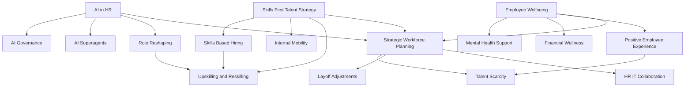

## HR Navigates the Human-AI Era: Live Trends as of November 2026

As November 5, 2026, unfolds, the world of Human Resources is buzzing with dynamic shifts, balancing technological advancement with essential human-centric approaches. HR professionals are no longer just administrative support; they are strategic architects, guiding organizations through unprecedented changes in how we work and lead.

Here are the actual live trends shaping HR right now:

**1. The Rise of Agentic AI and Intelligent Automation**
Artificial intelligence continues its rapid integration into HR, moving beyond simple generative tasks to "agentic AI" and "superagents" that can autonomously execute complex, multi-step workflows across the entire employee lifecycle. From refining recruitment processes and providing hyper-personalized employee experiences to automating learning and development tasks, AI is becoming the "system layer" connecting work across the business. This isn't about job elimination; rather, AI is reshaping job responsibilities, creating new roles, and necessitating significant upskilling and reskilling efforts. The imperative for HR is to lead AI strategy, ensuring ethical judgment and robust governance to manage compliance risks.

**2. Skills-First Talent Strategy Takes Center Stage**
The shift to skills-based hiring is no longer an emerging concept but a mainstream practice. Approximately 70% of employers now report using skills-based hiring, moving past traditional degree requirements to evaluate candidates on actual capabilities. This approach is crucial for expanding talent pools and addressing persistent talent scarcity, with critical skills gaps still challenging organizations. Internal talent marketplaces and continuous learning initiatives are vital components, fostering internal mobility and ensuring the workforce adapts to the estimated 39% of core skills expected to change by 2030.

**3. Holistic Employee Well-being as a Strategic Imperative**
Employee well-being has become a strategic priority, extending far beyond traditional perks to encompass mental, emotional, and financial health. Employers are prioritizing mental health support through expanded benefits, Employee Assistance Programs (EAPs), and mental health days, while also offering flexible fitness benefits and supporting financial wellness initiatives. This personalized and integrated approach to well-being is directly linked to improving employee experience, reducing turnover, and enhancing productivity.

**4. Navigating Workforce Optimization and Adjustments**
On a sobering note, "live news" from November 5, 2026, indicates that nearly two-thirds (66%) of HR leaders in the U.S. anticipate layoffs in 2027, a significant increase from previous years. While severance packages are becoming tighter, companies are increasing access to comprehensive career transition services for departing employees, including one-on-one coaching and online tools. This highlights the ongoing need for HR to manage workforce adjustments with empathy, strategic foresight, and clear communication, maintaining employee trust amidst change.

HR's role in 2026 is complex and critical. Success hinges on a balanced approach: leveraging cutting-edge technology responsibly, championing a skills-first mindset, prioritizing holistic employee well-being, and expertly navigating workforce planning and transitions.

