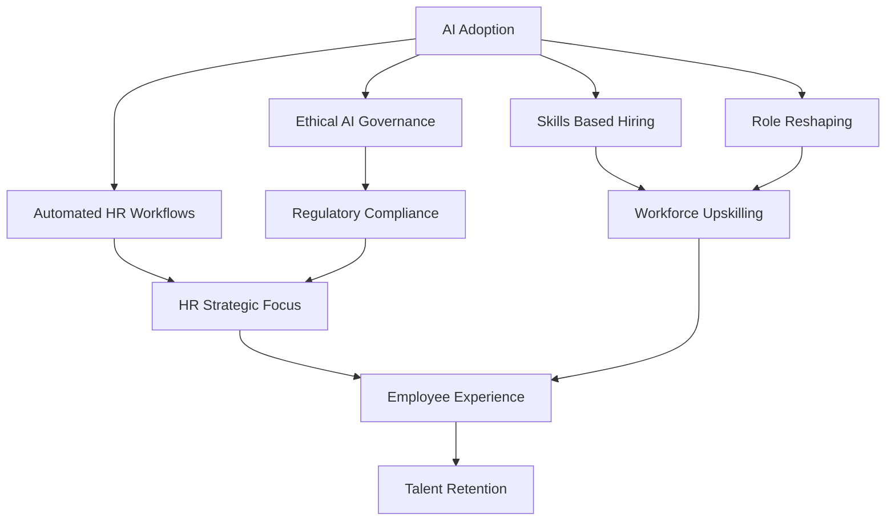

## HR in 2026: Navigating the AI Era and Human-Centric Shifts

As of November 2026, the Human Resources landscape is experiencing a profound transformation, primarily driven by the accelerating adoption of Artificial Intelligence (AI) and a renewed focus on the human element of work. HR professionals are no longer just administrators; they are strategic architects balancing technological innovation with evolving employee expectations and complex compliance needs.

AI is undeniably the dominant force reshaping HR functions. Nearly half of all organizations are expected to integrate AI into their HR operations this year, influencing everything from recruitment and performance management to learning and development and administrative workflows. AI tools are streamlining processes, automating routine tasks, and shifting the focus towards skills-based hiring rather than traditional degree requirements. This move is not just about efficiency; it's about making HR more strategic by freeing up professionals for higher-value work. However, the rapid pace of AI adoption also brings challenges, including concerns about AI bias in areas like salary recommendations and the urgent need for robust ethical governance and compliance frameworks.

Beyond technology, the human aspect remains critical. Employee experience, holistic well-being (including mental health), and engagement are paramount for talent retention and building resilient company cultures. Organizations recognize that employees expect flexible, intuitive digital workflows and a workplace that genuinely cares for their well-being. This emphasis on employee experience intertwines with the shift towards continuous upskilling and reskilling, as the workforce adapts to roles reshaped by AI. HR's role is evolving from a support function to a strategic operator, guiding organizations through continuous change and balancing people needs with business resilience.

Navigating this dynamic environment also means grappling with a complex regulatory landscape and concerns about workforce stability. While AI is more likely to redesign roles and create new ones than eliminate jobs entirely, some HR leaders anticipate layoffs in 2027. This necessitates careful strategic workforce planning and transparent communication.

In essence, 2026 is defining HR as an essential driver of enterprise value, blending cutting-edge technology with a deeply human-centered approach.

