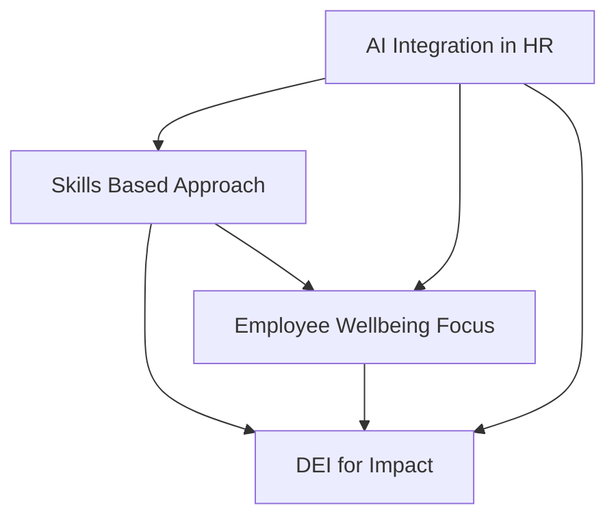

## HR in 2026: Navigating the Human-AI Nexus and the Skills-First Revolution

**November 8, 2026** – As we cruise through late 2026, the HR landscape isn't just evolving; it's undergoing a fundamental transformation. The buzzwords of yesterday are today's operational realities, with technology and a renewed focus on human potential reshaping how organizations attract, develop, and retain talent. For HR leaders, this era demands a blend of digital fluency, strategic foresight, and unwavering empathy.

One of the most significant shifts is the pervasive **integration of AI in HR**. AI is no longer a futuristic concept but an embedded infrastructure, automating routine tasks from CV screening and interview scheduling to payroll queries and policy lookups. This frees HR professionals to focus on higher-value activities like culture building, employee experience, and strategic workforce planning. The rise of "agentic AI" and "superagents" is transforming entire HR workflows, driving efficiency and enhancing decision-making with predictive analytics.

Closely intertwined with AI is the **Skills-Based Approach** to talent management, now considered the "operating system of work." Organizations are moving beyond traditional job titles and educational qualifications, prioritizing specific skills for hiring, development, and internal mobility. This approach is critical for organizational agility, helping companies adapt to rapidly changing market demands and build a more versatile workforce. AI plays a pivotal role here, powering skills matching, identifying skill gaps, and facilitating continuous learning and upskilling initiatives.

Meanwhile, **Employee Well-being** has firmly transitioned from a standalone program to a core organizational infrastructure. The conversation has expanded from mental health to "mental fitness," emphasizing proactive resilience-building. Financial well-being has also emerged as a top stressor, requiring employers to offer more comprehensive support. Holistic well-being strategies are addressing the impacts of workload, hybrid work models, and external societal pressures on employees.

Finally, **Diversity, Equity, and Inclusion (DEI)** is evolving beyond policy statements to measurable impact and strategic integration. The focus has shifted to demonstrating real outcomes and embedding fairness into core business processes like hiring, performance evaluations, and leadership development. Organizations are facing increased pressure to move past symbolic gestures and show tangible progress, with some even rebranding initiatives to better resonate with diverse cultural and political contexts.

The future of HR in 2026 is one where technology amplifies human potential, skills drive organizational agility, and well-being and genuine inclusion are non-negotiable foundations for success.

