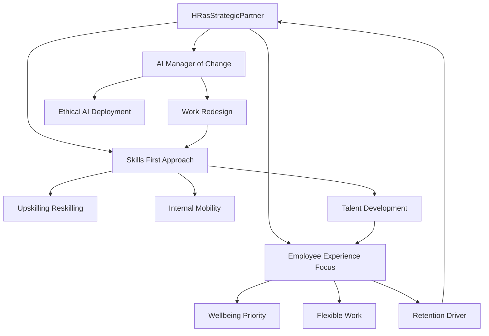

## HR at the Helm: Navigating the Future of Work in Late 2026

As of November 2026, Human Resources is not merely adapting to change; it's actively architecting the future of work. The landscape is dynamic, with technological advancements, evolving employee expectations, and the demand for strategic impact pushing HR into a central, transformative role. Here's a look at the actual live news shaping HR trends right now.

### AI Integration and the Redesign of Work

The integration of Artificial Intelligence (AI) and automation is profoundly reshaping how work gets done. HR teams have focused heavily on AI adoption, moving beyond simply selecting tools to redesigning workflows to drive value. Agentic AI, capable of autonomously thinking, planning, and acting to achieve multi-step goals, is emerging as a critical human capital management capability. This necessitates a thoughtful approach to human-AI collaboration, with HR at the forefront of rethinking the skills and structures needed for these evolving workforces. Ethical AI deployment, addressing concerns like data privacy and algorithmic bias, is also a key focus for HR leaders.

### Elevating Employee Experience and Wellbeing

Employee experience (EX) has solidified its position as a top priority for organizations. Companies are recognizing that a positive EX directly impacts productivity, retention, and overall company culture. This includes offering flexible working options, personalized benefits, and meaningful career development opportunities to keep employees engaged and motivated. Furthermore, employee wellbeing, including mental health, remains a critical HR trend, with leaders moving from reactive support to proactive, data-driven approaches to protect employee health and organizational productivity. Burnout, in particular, has become a board-level risk, making proactive prevention a core business priority.

### The Skills Revolution and HR's Strategic Evolution

A significant shift towards a skills-based approach is underway in HR. Organizations are increasingly focusing on upskilling and reskilling their workforce to address critical skills gaps, moving away from traditional job titles as the primary building blocks of work. Internal mobility is gaining importance as a talent source, driven by the need to redeploy employees into new roles as work changes. This evolving landscape demands that HR moves from a supportive function to a strategic operator, demonstrating clear, measurable business outcomes and guiding organizations through continuous change. HR's ability to provide insight into how technology impacts people is becoming indispensable.

As we look ahead, HR is positioned at the heart of organizational transformation, balancing technological innovation with human-centered strategies to build resilient and thriving workplaces.

