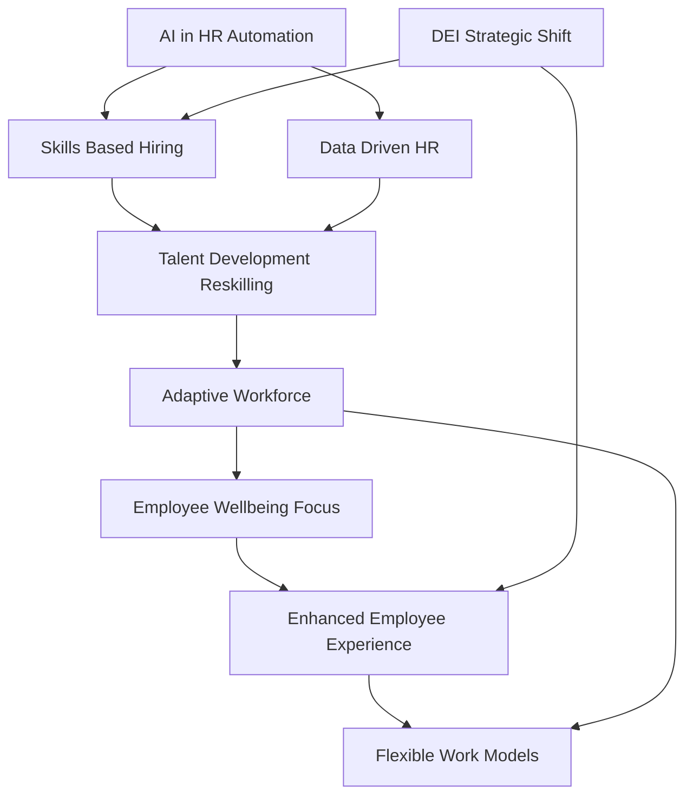

## HR in Hyperdrive: Navigating the 2026 Talent Landscape

**November 14, 2026** – The world of Human Resources is no stranger to change, but 2026 has ushered in an era of unprecedented transformation. As organizations grapple with rapidly evolving technology, shifting employee expectations, and an ongoing focus on human-centric workplaces, HR is firmly at the strategic helm, steering businesses through a complex, dynamic talent landscape.

**AI's Ascendancy and the Reskilling Revolution**
Artificial Intelligence is no longer a futuristic concept; it's a fundamental operating system for HR. By 2026, nearly half of all organizations are expected to be leveraging AI in HR functions, from intelligent recruitment tools to advanced workforce analytics. This isn't just about automation; it's about shifting job responsibilities and creating entirely new roles, requiring a significant focus on upskilling and reskilling the workforce to effectively collaborate with AI copilots. The demand for digital literacy and AI adaptability is paramount.

**The Rise of Skills-Based Hiring**
Degrees are taking a backseat to demonstrated capabilities. In 2026, employers are increasingly prioritizing skills-based hiring, focusing on what candidates can actually do rather than just their academic qualifications or previous job titles. This approach broadens talent pools and emphasizes transferable skills, creating more flexible career pathways. The concept of a "skills passport" is gaining traction as a comprehensive record of an individual's abilities throughout their career.

**Holistic Employee Wellbeing as a Strategic Imperative**
Employee wellbeing, encompassing mental, emotional, and financial health, has solidified its position as a core business strategy. Organizations are moving beyond reactive mental health support to proactive "mental fitness" initiatives, fostering resilience before burnout occurs. Financial wellbeing is also seeing increased investment, recognizing its link to overall employee stress. Providing specific support for women's health is also an emerging priority, with Gen Z, Millennial, and Gen X employees increasingly expecting robust offerings.

**Flexible Work: The New Standard**
Hybrid work has transcended being a temporary solution to become the dominant and expected operating model. Employees overwhelmingly prioritize flexibility, with many willing to accept lower pay for adaptable schedules and locations. Organizations are now optimizing hybrid models with smarter technology and intentional strategies to maintain connection and productivity, rather than debating the "where" of work.

**Evolving DEI Strategies**
Diversity, Equity, and Inclusion (DEI) initiatives are undergoing a significant recalibration. While still crucial, the focus is shifting towards opportunity-based frameworks, ensuring equitable access and fostering a sense of belonging for all employees. Leading organizations are embedding fairness and inclusion directly into their operational infrastructure, tying DEI efforts to measurable business outcomes like innovation and market growth, moving beyond symbolic gestures. This requires careful navigation of changing legal landscapes and ensuring programs are broadly accessible.

As HR continues to integrate technology with human ingenuity, leveraging data-driven insights and prioritizing employee experience, it remains pivotal in shaping resilient and high-performing organizations for the future.

