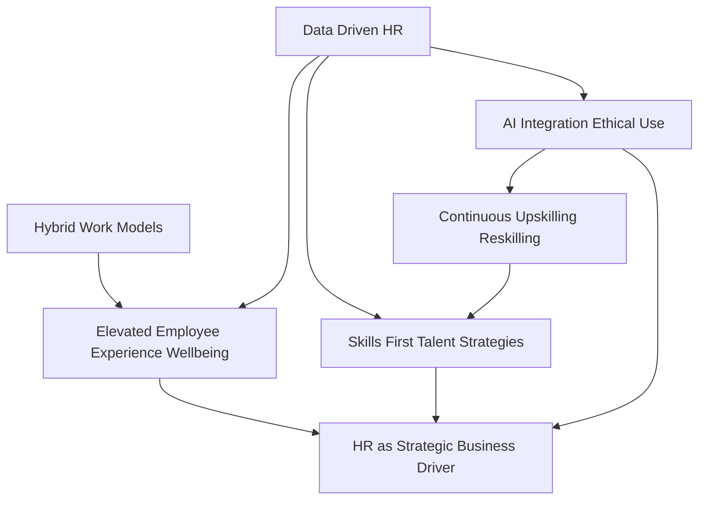

## HR's Evolving Horizon: Navigating 2026's Core Trends

As of November 22, 2026, the Human Resources landscape is experiencing a profound transformation, moving beyond reactive functions to become a strategic pillar of organizational success. This year marks a pivotal shift, where companies are actively operationalizing advancements that were once theoretical, redefining how we work and lead.

Here are the key trends shaping HR right now:

### AI Integration and Ethical Adoption

Artificial Intelligence is no longer an emerging concept but an operational reality within HR, significantly enhancing efficiency in areas like recruitment, onboarding, and workforce analytics. The current focus is on the responsible deployment of AI, with HR playing a critical role in establishing ethical guidelines, mitigating bias, and fostering employee trust in AI systems. Automation is liberating HR professionals from routine tasks, allowing them to concentrate on more strategic, human-centric initiatives.

### Skills-First Talent Strategies

A prominent shift is underway towards skills-based hiring, prioritizing demonstrated capabilities and competencies over traditional academic credentials to address critical skill gaps effectively. This approach necessitates a continuous commitment to upskilling and reskilling the workforce, with learning increasingly integrated directly "in the flow of work" to ensure adaptability in rapidly evolving job markets. Internal talent marketplaces are expanding, facilitating employee growth and mobility within organizations.

### Elevated Employee Experience and Wellbeing

Cultivating a human-centric culture with a holistic focus on employee wellbeing, including robust mental health support, is paramount for driving engagement and productivity today. Organizations are prioritizing personalized employee experiences, recognizing that factors like work-life balance and a sense of purpose are crucial for job satisfaction and loyalty. While hybrid work models are now standard, their success hinges on clear structures and well-defined policies to optimize collaboration and focus.

### HR as a Strategic Business Driver

The HR function has firmly cemented its role as a strategic business partner, actively aligning workforce initiatives with broader organizational goals and leveraging data for proactive decision-making. Strategic workforce planning, powered by advanced people analytics, is essential for dynamically orchestrating talent and capabilities to meet evolving business demands. Furthermore, pay transparency is gaining significant traction as a key differentiator for building trust and attracting top talent.

In late 2026, HR's mandate is clear: balance technological innovation with human empathy, create strategic value, and build resilient, skilled, and genuinely supported workforces ready for the future.

