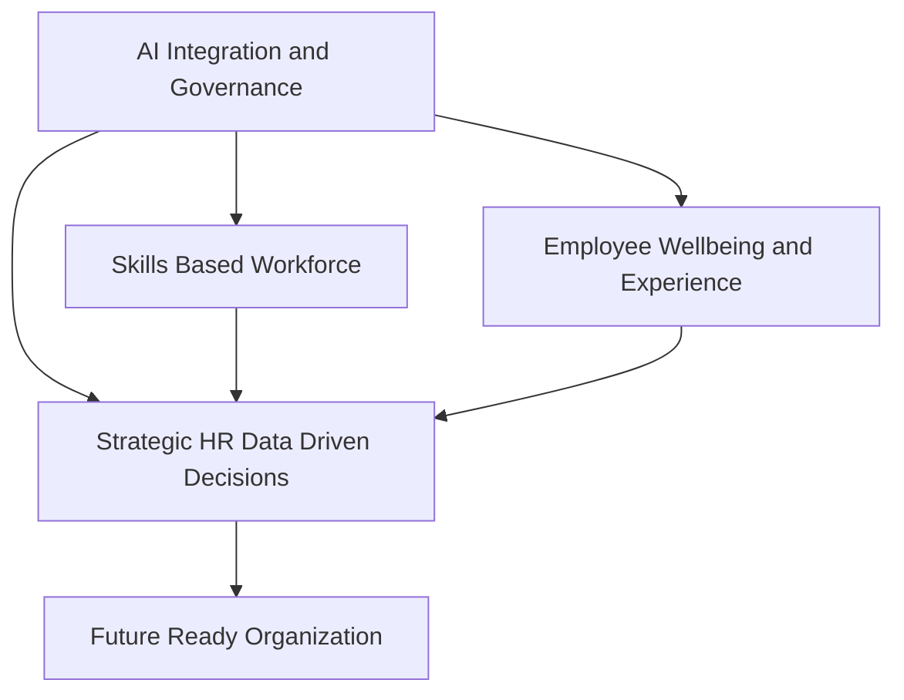

## Navigating 2026: The Live Pulse of HR Transformation

As we close out 2026, the HR landscape is less about incremental shifts and more about foundational transformations. The profession is cementing its role as a strategic imperative, deftly balancing technological innovation with an unwavering commitment to the human element. Here's a concise look at the actual live news shaping HR right now.

### AI Integration: Beyond Experimentation to Core Operations

Artificial Intelligence has moved decisively past the experimental phase and is now embedded deeply into core HR operations. From automating resume screening and interview scheduling to streamlining onboarding processes, AI is significantly enhancing efficiency in daily workflows. However, this rapid integration brings a critical challenge: an impending "AI training crisis" where only a small fraction of firms have adequately prepared employees for new AI-driven roles and job redesigns. HR's new mandate includes co-creating governance frameworks for ethical AI deployment and ensuring transparency in how algorithms impact work.

### The Ascendancy of the Skills-Based Workforce

The traditional emphasis on job titles is rapidly being superseded by a focus on skills. Organizations are increasingly prioritizing what individuals *can do* over their historical roles or educational background. This shift is redefining hiring practices, talent development, and even compensation models, pushing employers to reward strategic judgment, AI workflow design, and risk accountability. It necessitates robust internal mobility programs and clearer pathways for employees to acquire and apply new capabilities.

### Prioritizing Employee Well-being and the Holistic Experience

Employee well-being continues to be a top-tier priority, with expectations around employer responsibility consistently rising. Psychological health is no longer a side note but a board-level risk directly impacting productivity and performance. HR leaders are investing in comprehensive well-being programs, mental health support, and fostering a human-centric culture that views pay, culture, flexibility, and meaningful work as intertwined elements shaping satisfaction and loyalty. The emergence of "People Experience Departments" signifies a move towards a more holistic approach to talent management, focusing on the entire employee journey.

### HR as a Strategic Operator: Data-Driven and Adaptive

HR is firmly transitioning from a support function to a strategic operator, guiding organizations through continuous change and balancing people needs with business resilience. This involves a greater emphasis on strategic workforce planning and leveraging people analytics to make informed decisions, especially in the prevalent hybrid work environments. As new employment laws (like the upcoming changes to unfair dismissal rules in the UK) and regulatory shifts emerge, HR's role in ensuring compliance and trust within a dynamic global workforce becomes even more critical.

The current moment for HR is defined by accelerating change. Success in this evolving landscape hinges on an intelligent, adaptable, and deeply human approach.

