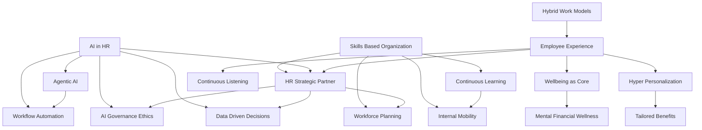

**HR's Evolving Horizon: Navigating the Future at the Close of 2026**

As November 2026 draws to a close, the Human Resources landscape is experiencing a period of intense transformation, driven by technological advancements, shifting employee expectations, and the ongoing redefinition of work itself. HR is no longer merely a support function; it's rapidly becoming a strategic imperative, shaping organizational agility and resilience.

A dominant force continues to be **Artificial Intelligence (AI)**, moving from experimental phases to practical, workflow-embedded applications. While 97% of large organizations and 92% of midsized organizations are now using or piloting AI, many still grapple with demonstrating a clear return on investment. AI is streamlining routine tasks in recruitment, onboarding, performance management, and workforce planning, with "agentic AI" emerging to handle multi-step goals autonomously. However, the real opportunity lies in a human-centric approach, where AI augments human judgment rather than replacing it, demanding closer HR-IT collaboration and robust ethical governance.

The paradigm shift towards **Skills-Based Organizations (SBOs)** is accelerating, prioritizing verified capabilities over traditional job titles and degrees. This model fuels continuous learning, agile talent deployment, and enhanced internal mobility, directly impacting workforce planning and organizational adaptability. HR's role is critical in embedding skills thinking into business strategy and investing in the necessary talent development infrastructure.

**Employee Experience (EX) and holistic well-being** are now central to business success, seen as multipliers of performance and retention. Organizations are striving for "hyper-personalization," leveraging AI to create dynamic, adaptive digital workplaces that cater to individual needs and evolving life stages, moving beyond one-size-fits-all benefits packages. This includes a growing emphasis on mental fitness, financial wellness, and specific support for women's health, particularly driven by Gen Z and Millennial expectations. Continuous listening, through pulse surveys and sentiment analysis, is replacing less frequent annual reviews to capture real-time feedback.

Finally, the **evolution of work models** continues, with hybrid work solidifying as the "new normal" for many, blending in-office collaboration with remote focus. While fully remote hiring has decreased from its peak, it remains significant for skilled professionals. This dynamic environment elevates HR to a truly strategic partner, influencing board-level decisions, navigating complex compliance landscapes, and focusing on retaining talent (which outranks attracting new talent as a top priority for many) by demonstrating tangible impact on business performance.

In essence, HR leaders at the close of 2026 are tasked with a delicate balance: harnessing the power of technology while amplifying the human element, ensuring adaptability, well-being, and strategic value in an ever-changing world.

