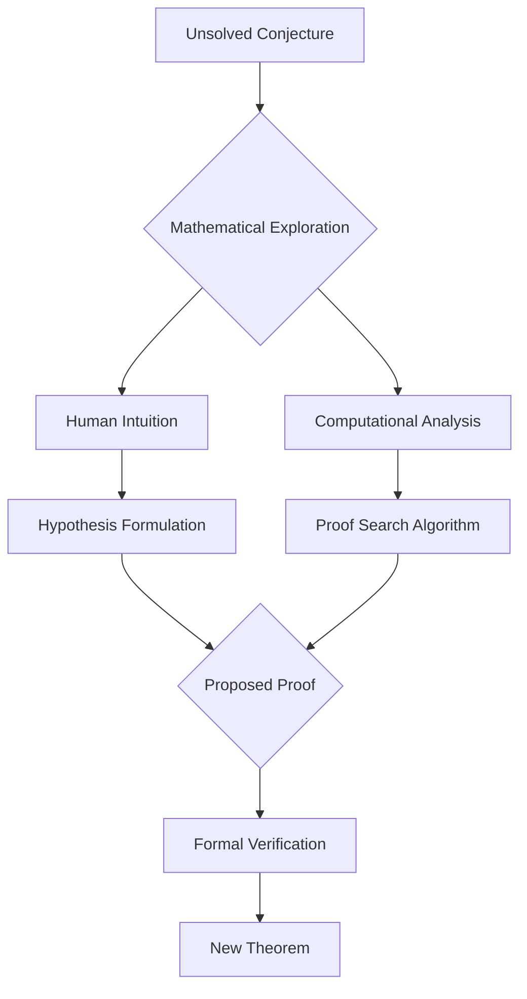

## October 2026: A Landmark Month in Mathematics

As October 2026 unfolds, the world of mathematics is buzzing with significant announcements that underscore the dynamic and ever-evolving nature of the discipline. From prestigious awards recognizing towering achievements to groundbreaking methodologies, the past few months have been nothing short of transformative.

### Abel Prize Honors Gerd Faltings

This year's Abel Prize, often dubbed the "Nobel Prize of Mathematics," was awarded on March 19, 2026, to German mathematician Gerd Faltings. Faltings, a director emeritus at the Max Planck Institute for Mathematics, was recognized "for introducing powerful tools in arithmetic geometry and solving long-standing diophantine conjectures by Mordell and Lang." His work is celebrated for its profound impact, unifying number theory and abstract geometric forms, and reshaping the field by settling major conjectures and establishing new foundational frameworks.

### ICM 2026 Celebrates Fields Medalists

The mathematical community converged in Philadelphia from July 23-30, 2026, for the International Congress of Mathematicians (ICM 2026). A highlight of the congress was the awarding of the coveted Fields Medals on July 23, recognizing exceptional mathematical achievement in existing work and the promise of future breakthroughs for mathematicians under 40.

The four distinguished recipients of the 2026 Fields Medals are:
*   **Yu Deng** (University of Chicago, USA) for contributions to placing the laws of physics on a rigorous mathematical foundation.
*   **John Pardon** (Stony Brook University, USA)
*   **Jacob Tsimerman** (University of Toronto, Canada)
*   **Hong Wang** (New York University and IHES, France) for solving the three-dimensional Kakeya conjecture, a major open problem in harmonic analysis.

These mathematicians exemplify the depth, originality, and vitality of contemporary mathematics, with their work spanning diverse subfields.

### AI's Ascendance in Mathematical Proof

Adding to the excitement of 2026, a significant milestone was reached with the announcement of the first AI-discovered proof of a major conjecture. An AI system named LeanMind, developed by a team at the Institute for Advanced Study and DeepMind, independently discovered a proof for the Sylvester-Gallai conjecture in a special Euclidean geometry. This groundbreaking achievement, formally verified by the Coq system, signifies a paradigm shift where AI can not only verify but also inspire new mathematical frameworks without substantial human guidance. This heralds a new era of human-AI collaboration in mathematical discovery.

The process of mathematical discovery is becoming increasingly intricate, blending traditional methods with cutting-edge technology:

These recent developments—from the recognition of established brilliance to the unveiling of new frontiers in discovery—paint a vibrant picture of a field continually pushing the boundaries of human, and now artificial, intellect.