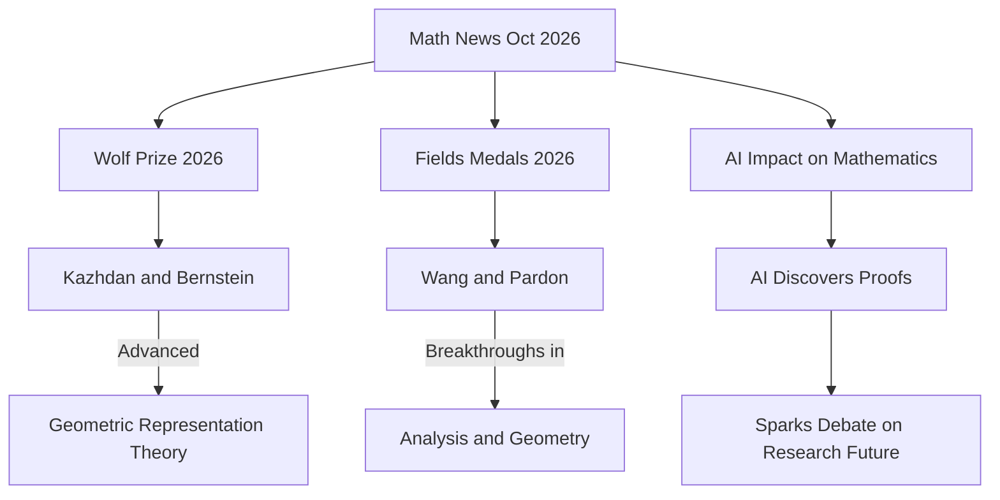

## Mathematics in the Spotlight: October 2026 Sees Major Awards and AI Debates

As October 2026 unfolds, the world of mathematics is buzzing with significant announcements, from prestigious awards recognizing foundational work to ongoing discussions about the transformative role of artificial intelligence. It's a vibrant time for the discipline, showcasing both enduring human ingenuity and the evolving landscape of discovery.

Just last week, on October 1st, David Kazhdan of the Hebrew University of Jerusalem and Joseph Bernstein of Tel Aviv University were jointly awarded the **2026 Wolf Prize in Mathematics**. They were honored for their "foundational work on representation theory, automorphic forms and algebraic geometry, and their role in creating geometric representation theory". Their contributions have been instrumental in forging new connections between seemingly disparate mathematical fields, establishing a powerful new language for understanding symmetry and structure.

Earlier in the year, in July, the highly anticipated **Fields Medals** were conferred at the International Congress of Mathematicians (ICM) in Philadelphia. Among the celebrated laureates was Hong Wang, recognized for her groundbreaking work in harmonic analysis and geometric measure theory, including a significant advance on the three-dimensional Kakeya conjecture. Jack Pardon also received the medal for his achievements in symplectic geometry. Often dubbed the "Nobel Prize of mathematics," the Fields Medal celebrates outstanding achievements by mathematicians under 40, along with the promise of future breakthroughs.

Meanwhile, the rapid ascent of **Artificial Intelligence (AI) in mathematics** continues to be a dominant, and sometimes contentious, theme throughout 2026. AI models have demonstrated an astonishing ability to discover proofs for long-standing conjectures, with instances like an AI system called LeanMind, in collaboration with the Institute for Advanced Study and DeepMind, proving the Sylvester-Gallai conjecture in a special Euclidean geometry. Another AI model, OpenAI's Astra, solved a key problem in group theory in August, and Anthropic's Claude reportedly discovered a subquadratic algorithm for a problem related to (min,+)-convolution. These breakthroughs have sparked intense debate among mathematicians regarding authorship, the nature of mathematical understanding, and the future direction of human-led research in an age where AI can generate proofs with unprecedented speed.

The year 2026, designated as the "Year of Mathematics" in the United States, is indeed proving to be a landmark period, highlighting both the pinnacle of human mathematical thought and the exciting, and sometimes challenging, frontier where human and artificial intelligence intersect.

