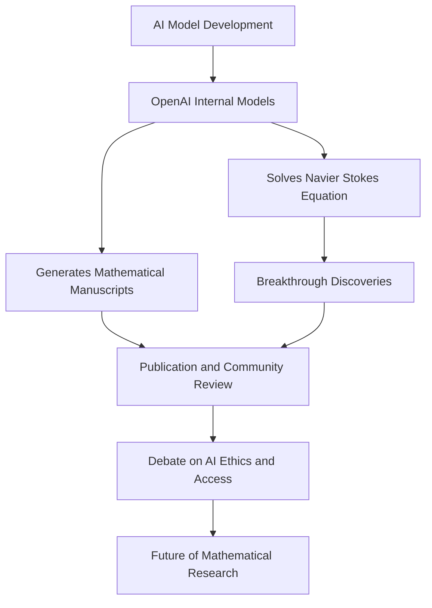

## Mathematics in the Machine Age: AI-Driven Discoveries Reshape the Field

As of October 8, 2026, the world of mathematics is buzzing with discussions surrounding the unprecedented advancements in artificial intelligence and its direct impact on groundbreaking discoveries. While 2026 has already seen the prestigious Abel Prize awarded to Gerd Faltings for his profound contributions to arithmetic geometry, and four brilliant minds recognized with the Fields Medals, the most immediate and provocative news stems from the realm of AI.

Just this week, OpenAI made headlines by releasing hundreds of mathematical manuscripts generated by its internal frontier AI models. These manuscripts cover a wide array of research problems across mathematics and theoretical computer science, including proofs and supporting materials. This follows an earlier monumental achievement by OpenAI in solving the Navier-Stokes equation, a problem that has eluded mathematicians for decades and carried a $1 million reward.

The rapid pace of AI-driven mathematical discovery has ignited a crucial debate within the global mathematical community. Experts, including the Institute for Advanced Study in Princeton, New Jersey, are raising concerns about the implications of AI models generating arguments that human mathematicians may not fully understand or be able to verify independently. The transparency and accessibility of these proprietary AI models are also points of contention, with fears of creating a "two-tier system" in mathematical research.

This era marks a significant shift, as AI moves beyond assisting with complex calculations to actively formulating conjectures and proving theorems with minimal human intervention. The ongoing conversation highlights the need for a new paradigm that integrates human understanding and oversight with the powerful capabilities of artificial intelligence, shaping the very future of how mathematical research is conducted and validated.

Here's a simplified overview of this evolving landscape:

