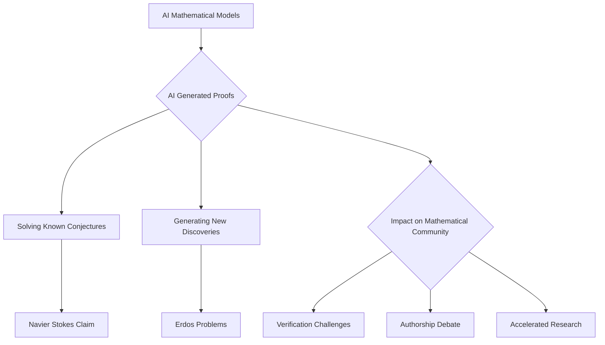

## Mathematics in Flux: AI breakthroughs Reshape the Landscape (October 10, 2026)

As we stand on October 10, 2026, the world of mathematics is abuzz with activity, particularly regarding the burgeoning role of artificial intelligence. This year has already seen significant human achievements celebrated, alongside a rapidly evolving dialogue around AI's capabilities and its profound impact on mathematical discovery.

One of the most immediate and hotly debated topics centers on the recent actions of OpenAI. Just this week, on October 6, 2026, OpenAI released "hundreds of new mathematical findings," showcasing over 370 results across diverse fields like algebra, theoretical computer science, and mathematical logic. Even more remarkably, in September 2026, OpenAI claimed that an internal model, reportedly more powerful than GPT-6 Astra, had solved the formidable Navier-Stokes existence and smoothness problem—one of the Millennium Prize Problems carrying a million-dollar reward.

However, this rapid influx of AI-generated mathematics has ignited widespread discussion within the global mathematical community. Concerns have been raised regarding the verification of these proofs, the transparency of proprietary AI models, and the very concept of authorship in this new era. Many mathematicians are now grappling with how to integrate, verify, and understand results produced by systems that may operate beyond immediate human comprehension, prompting calls for "equitable access" to these advanced AI tools. Nevertheless, AI has already made verified strides, including proving four Erdős problems in February 2026 and nine more in May 2026, alongside improving bounds for Ramsey numbers and disproving the unit distance problem.

Beyond the AI frontier, 2026 has also honored individual brilliance. The prestigious **Abel Prize 2026** was awarded in March to German mathematician Gerd Faltings, director emeritus at the Max Planck Institute for Mathematics. Faltings was recognized for his "powerful tools in arithmetic geometry" and for solving long-standing Diophantine conjectures, notably those of Mordell and Lang.

The **Fields Medals**, often considered the "Nobel Prize of mathematics" for younger researchers, were also announced in July 2026 at the International Congress of Mathematicians (ICM) in Philadelphia, USA. This year's recipients include Yu Deng (for work on partial differential equations and deriving the Boltzmann equation), Hong Wang (for advances in harmonic analysis and the Kakeya problem in three dimensions, making her the first Chinese woman to receive the honor), John Pardon, and Jacob Tsimerman.

The year 2026 is truly proving to be a watershed moment for mathematics, marked by both monumental human achievements and the challenging, yet exciting, emergence of artificial intelligence as a potent force in discovery.

