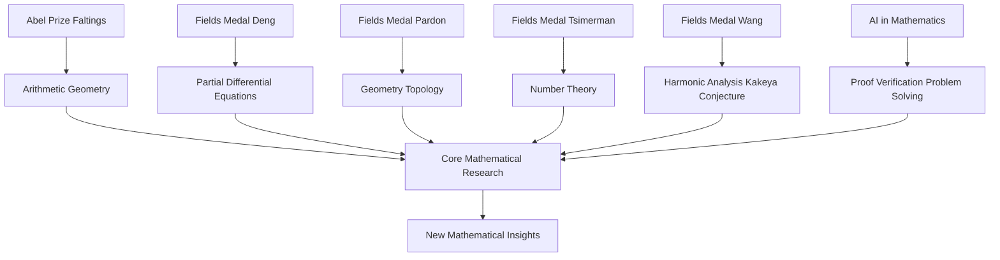

**Mathematics in Motion: A Look at 2026's Landmark Discoveries and Honors**

October 12, 2026 – The world of mathematics has witnessed a vibrant year of breakthroughs and significant accolades, underscoring the relentless pursuit of understanding that defines this fundamental science. From prestigious awards recognizing decades of profound work to cutting-edge advancements powered by artificial intelligence, 2026 continues to be a landmark year.

This past July 23, the mathematical community celebrated the announcement of the 2026 Fields Medals at the International Congress of Mathematicians (ICM) in Philadelphia. Often likened to the "Nobel Prize of mathematics," this esteemed award is presented every four years to mathematicians under 40 for outstanding achievement and the promise of future contributions. The four brilliant minds honored this year include Yu Deng of the University of Chicago, recognized for his work on partial differential equations; John Pardon of Stony Brook University; Jacob Tsimerman of the University of Toronto; and Hong Wang of New York University and France's Institut des Hautes Études Scientifiques (IHES). Notably, Hong Wang is the third woman in the award's 90-year history to receive this highest honor, partly for her resolution of the three-dimensional Kakeya set conjecture. Deng's contributions, for instance, include deriving the Boltzmann equation from "billiard ball" dynamics.

Earlier in the year, on March 19, German mathematician Gerd Faltings was named the recipient of the 2026 Abel Prize. The Norwegian Academy of Science and Letters awarded Faltings this distinguished honor for his "introducing powerful tools in arithmetic geometry and resolving long-standing diophantine conjectures of Mordell and Lang". His work has been lauded for reshaping the field and uniting geometric and arithmetic perspectives.

Beyond these major awards, 2026 has also highlighted the accelerating role of artificial intelligence in mathematical discovery. AI systems are increasingly contributing to the generation and verification of proofs, leading to new insights and even resolving previously open problems. For example, in February 2026, Google DeepMind's Gemini model reportedly surveyed 700 open Erdős problems, proving four and finding nine unknown published solutions. The formalization of complex proofs, such as Maryna Viazovska's work on sphere packing, by AI agents like Math Inc.'s Gauss, demonstrates a new era of human-machine collaboration in mathematics.

As the year progresses, these developments underscore the dynamic and evolving landscape of mathematical research, pushing the boundaries of human and artificial intellect alike.

