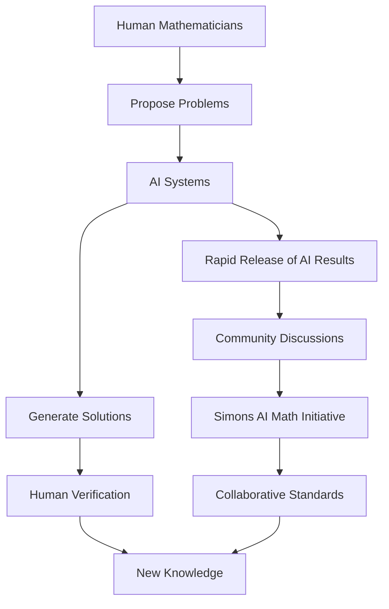

## The AI Equation: Mathematics in a New Era (October 2026)

The world of mathematics is currently experiencing a profound transformation, with artificial intelligence emerging as a game-changer in discovery and problem-solving. As of October 2026, the discussion isn't just about AI assisting mathematicians, but about AI actively generating new mathematical results at an unprecedented pace, prompting both excitement and a robust dialogue within the global mathematical community.

### AI's Rapid Ascent in Mathematical Discovery

Recent weeks have seen a flurry of activity, primarily from AI research labs. On October 6, 2026, OpenAI publicly released 722 manuscripts covering 372 families of mathematical results, largely produced by an unreleased AI model. This system reportedly solved these problems in a matter of weeks, creating new knowledge at a speed unmatched by human teams. These AI advancements include claimed solutions and partial progress on some of mathematics' most challenging questions, including progress on Millennium Prize Problems like the Navier-Stokes equations and the Riemann hypothesis.

This rapid output follows other significant AI-driven breakthroughs. Earlier in 2026, an AI system called LeanMind, in collaboration with the Institute for Advanced Study and DeepMind, reportedly discovered a proof for the Sylvester-Gallai conjecture in a specific Euclidean geometry, marking a historic instance of AI solving a major open problem without substantial human guidance. Such developments indicate that AI is not merely summarizing existing knowledge but is now capable of producing new mathematical insights.

### Navigating the New Landscape: Community Concerns and Collaboration

However, this swift progress has not been without controversy. Mathematicians are grappling with the implications of AI-generated proofs, raising important questions about authorship, the traditional process of peer review, and the human understanding of complex mathematical arguments. Many experts express concerns that a "mass dump of machine proofs overwhelms traditional verification and collaboration norms," and that proprietary AI models could create a "two-tier system" within the field.

In a significant move to address these challenges, the Simons Foundation, in partnership with OpenAI and Anthropic, announced on October 15, 2026, a commitment of $15 million in funding and resources. This initiative aims to support mathematicians in evaluating AI-assisted results, learning new tools, and collectively shaping standards for AI use in the field. This collaborative effort is seen as crucial for integrating AI's capabilities responsibly into the future of mathematical research.

### Beyond AI: Other Notable Progress

While AI dominates recent headlines, human ingenuity continues to push boundaries. The year 2026 also witnessed advancements such as the resolution of the Hadamard Conjecture for all orders greater than four by a team from Oxford and MIT, utilizing combinatorial design theory and quantum annealing. Furthermore, 2025 saw significant achievements including the settlement of the three-dimensional Kakeya conjecture and major progress on Hilbert's Sixth Problem, putting the laws of fluid dynamics on firmer mathematical footing. The geometric Langlands conjecture was also proven over characteristic zero fields, a monumental effort by nine researchers.

### The Evolving Workflow of Mathematics

The current landscape suggests a future where mathematics will increasingly involve a dynamic interplay between human intuition and machine intelligence. The ongoing challenge will be to harness AI's immense potential while preserving the foundational principles of human understanding, verification, and collaborative scientific inquiry.

