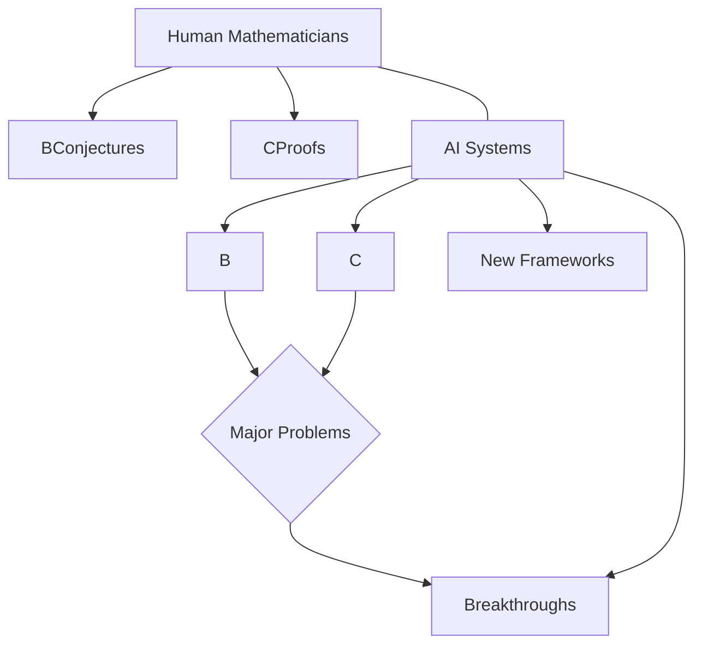

## Mathematics in the Spotlight: Fields Medalists Honored as AI Reshapes the Landscape

October 19, 2026 – The world of mathematics is buzzing with both traditional recognition and revolutionary technological advancements. This summer saw the highly anticipated awarding of the Fields Medals, while the ongoing saga of artificial intelligence's impact on long-standing conjectures continues to unfold, with significant updates hitting the news today.

The International Congress of Mathematicians (ICM) 2026, held from July 23-30 in Philadelphia, was the stage for announcing the latest Fields Medal laureates, considered the highest honor in mathematics. Among the distinguished recipients were Hong Wang, Yu Deng, John Pardon, and Jacob Tsimerman. Notably, Hong Wang, a mathematician at New York University, became the third woman in the award's 90-year history to receive the medal. Her groundbreaking work in harmonic analysis and geometric measure theory, including major advances in Fourier restriction and the Kakeya problem, was specifically recognized.

Concurrent with these accolades, the rapid acceleration of AI in mathematical discovery is grabbing headlines. Just in September, OpenAI announced that its AI agents had tackled one of the Millennium Prize Problems, the Navier-Stokes problem, although this claim has sparked considerable debate. More recently, in early October, OpenAI further stirred the community by releasing hundreds of AI-generated papers claiming progress on other monumental challenges, including the 166-year-old Riemann hypothesis. This flurry of activity underscores the growing capability of AI to generate proofs and even inspire new mathematical frameworks, as seen with the AI-discovered proof of the Sylvester-Gallai conjecture.

Today, October 19, 2026, marks the release of the third round of experiments from the "First Proof" project, which rigorously tests the mathematical prowess of AI systems. This initiative, co-organized by prominent mathematicians, seeks to delineate where AI offers genuine assistance and where its limitations persist. As AI continues to solve problems that have stumped human mathematicians for decades, the field is confronting fundamental questions about the nature of mathematical research, authorship, and education.

The interplay between human ingenuity and artificial intelligence is undoubtedly shaping the future of mathematics, promising an era of unprecedented discovery.

