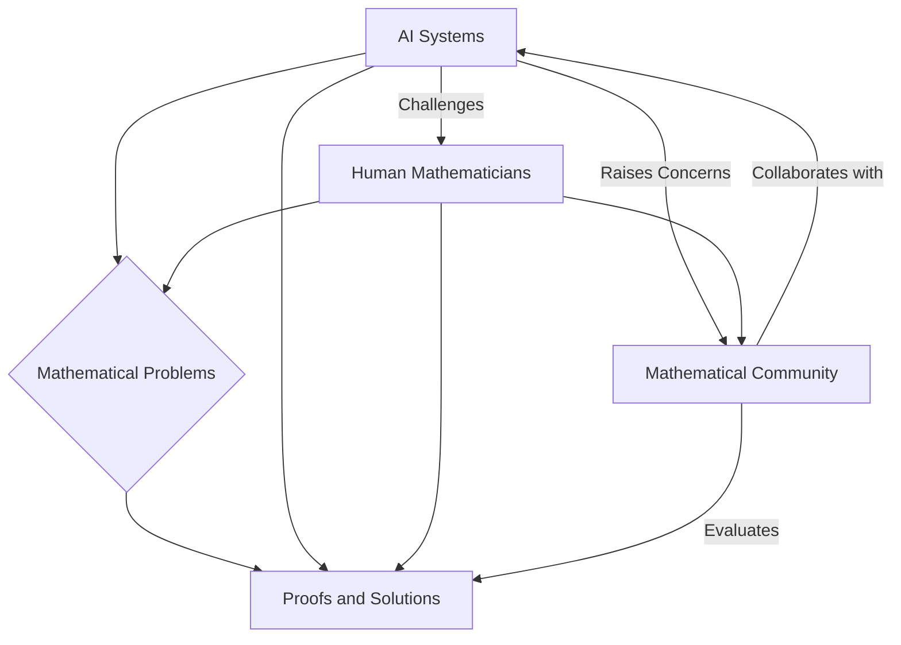

## AI Transforms Mathematics: A Glimpse into October 2026

As of October 21, 2026, the world of mathematics is abuzz with transformative developments, largely driven by the accelerating capabilities of Artificial Intelligence. The landscape is shifting rapidly, presenting both unprecedented breakthroughs and profound challenges to the established norms of mathematical research.

Today, Microsoft announced a significant achievement: the resolution of the Kannan-Lovász-Simonovits (KLS) conjecture, a 31-year-old grand challenge in high-dimensional geometry and probability. This breakthrough, published on October 21, 2026, was a testament to effective human-AI collaboration, combining novel mathematical ideas with AI-driven exploration. Researchers utilized AI systems to navigate mathematical possibilities, with human oversight guiding and refining the process, leading to a formally verified solution.

This news arrives amidst an ongoing maelstrom sparked by OpenAI's recent endeavors. In September and early October 2026, OpenAI made waves by claiming solutions to hundreds of open mathematical problems, including aspects of the formidable Navier-Stokes existence and smoothness problem, one of the Millennium Prize Problems. The company released a staggering 722 manuscripts of AI-generated proofs, prompting a mix of awe and skepticism within the mathematical community.

The sheer volume and nature of these AI-generated results have ignited intense debate. Mathematicians are grappling with questions of validity, authorship, and the very future of human-led research. Concerns have been raised about a "severe misalignment" between the goals of AI companies and those of the academic mathematical community, particularly regarding the process of discovery and the focus on understanding over mere problem-solving.

A consortium of leading mathematicians, known as "First Proof," has been actively evaluating the performance of AI systems on complex research problems. While acknowledging impressive gains, the consortium also highlights persistent shortcomings in AI's ability to clearly communicate solutions and provide proper citations.

Beyond the AI frontier, 2026 has also seen traditional accolades. The prestigious Fields Medals were awarded in July 2026, with Hong Wang becoming the third woman in the award's 90-year history to receive this highest honor in mathematics for her work on a decades-old geometry problem. Other recipients included Yu Deng, John Pardon, and Jacob Tsimerman for their contributions to diverse fields. The Ramanujan Prize for young mathematicians from developing countries was also announced in September 2026.

As AI continues to demonstrate remarkable capabilities, mathematics stands at a critical juncture. The resolution of problems like KLS through human-AI partnership offers a promising path forward, while the challenges posed by large-scale, AI-driven proof generation necessitate careful consideration and adaptation by the global mathematical community.

