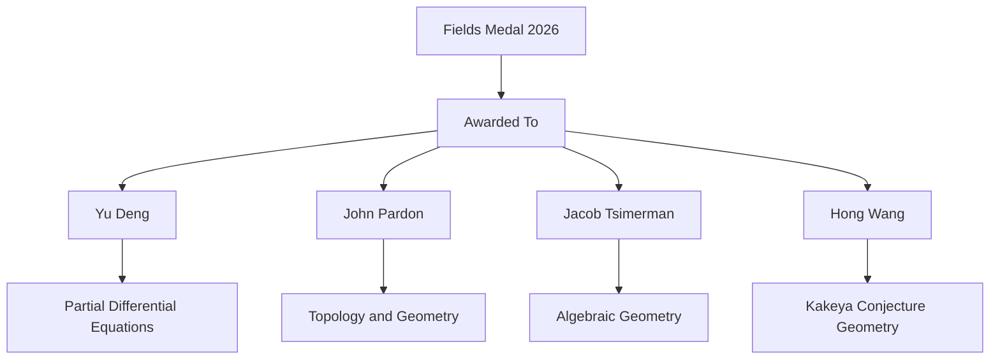

## Mathematical Excellence Illuminated: The 2026 Fields Medals and Abel Prize Honorees

As of October 22, 2026, the world of mathematics is still buzzing with the excitement of major accolades recently bestowed upon some of its brightest minds. The summer saw the quadrennial International Congress of Mathematicians (ICM) in Philadelphia, a pivotal event where the prestigious Fields Medals were awarded, alongside the announcement of the 2026 Abel Prize earlier in the year.

The 2026 Fields Medals, often regarded as the Nobel Prize of mathematics, were presented to four exceptional mathematicians at the ICM, which ran from July 23-30, 2026. These medals recognize outstanding mathematical achievement for mathematicians under 40 and promise future potential.

The distinguished recipients are:
*   **Yu Deng** of the University of Chicago, honored for his groundbreaking work in partial differential equations, including the rigorous derivation of the Boltzmann equation from hard-sphere dynamics.
*   **John Pardon** from Stony Brook University, recognized for solving significant problems in topology and geometry.
*   **Jacob Tsimerman** of the University of Toronto, who developed powerful new techniques in algebraic geometry, advancing progress on long-standing mathematical puzzles.
*   **Hong Wang** from New York University, celebrated for her contributions, including work on the Kakeya conjecture. Notably, Wang is only the third woman in the award's 90-year history to receive the Fields Medal.

These achievements underscore the vibrant and diverse research fronts pushing the boundaries of mathematical knowledge.

Earlier in March 2026, the mathematics community also celebrated the announcement of the Abel Prize. This year, the honor was awarded to **Gerd Faltings**, a German mathematician and director emeritus at the Max Planck Institute for Mathematics in Bonn. Faltings received the prize "for introducing powerful tools in arithmetic geometry and resolving long-standing Diophantine conjectures of Mordell and Lang". His work has been described as reshaping the field and establishing new frameworks that have guided decades of subsequent research.

The recognition of these outstanding mathematicians highlights the profound impact of abstract thought on our understanding of the universe and the ongoing quest to solve its deepest puzzles.

