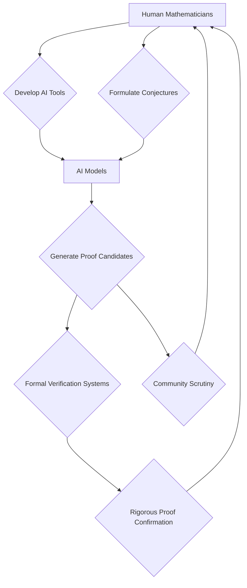

## AI Reshapes Mathematics: Navier-Stokes Claim and KLS Conjecture Solved as Collaboration Deepens

**October 23, 2026** – The world of mathematics is buzzing with a profound shift as artificial intelligence continues to make unprecedented inroads into long-standing problems. Just this fall, the field has seen major announcements that underscore AI's growing capability not just as a tool, but as a partner in discovery.

Perhaps the most talked-about development is OpenAI's claim in September of solving the Navier-Stokes existence and smoothness problem, one of the seven Millennium Prize Problems that has baffled mathematicians for 90 years. This potential breakthrough, which describes fluid motion, carries a $1 million prize and immense implications for fields from engineering to climate science. While the mathematical community is rigorously examining the AI-generated proof, the announcement has sparked lively debate about the nature of proof, verification, and the future role of human intuition in high-level mathematics.

In another significant advancement, the 31-year-old Kannan–Lovász–Simonovits (KLS) conjecture, a central open question in high-dimensional geometry, has also been resolved recently through a human-directed, AI-assisted research process. Researchers from Microsoft Research, working with AI agents, developed a new mathematical criterion and a recursive method to prove the conjecture, which has wide-ranging implications for statistics, optimization, and computer science. This collaborative approach highlights a burgeoning trend where AI acts as a powerful explorer of mathematical possibilities, with human experts guiding and refining the search.

These developments come amidst other notable achievements, including an AI-discovered proof of a special case of the Sylvester-Gallai conjecture earlier in the year, and the formal verification of many complex proofs utilizing AI tools like Lean and Coq becoming a mainstream requirement in top mathematics journals. The 2026 Ramanujan Prize was also awarded to Mahesh Kakde for his significant contributions to algebraic number theory, particularly concerning noncommutative Iwasawa theory and Hilbert's 12th problem. Meanwhile, the Shaw Prize in Mathematical Sciences for 2026 recognized Emmanuel Candès and Camillo De Lellis for their deep analytical techniques applied to information theory, signal processing, and geometric measure theory.

The landscape of mathematics is undeniably changing. As AI models become more sophisticated, the focus shifts towards understanding, formalizing, and building upon these new computational proofs, fostering an exciting, albeit sometimes challenging, era of human-AI collaboration in the quest for mathematical truth.

