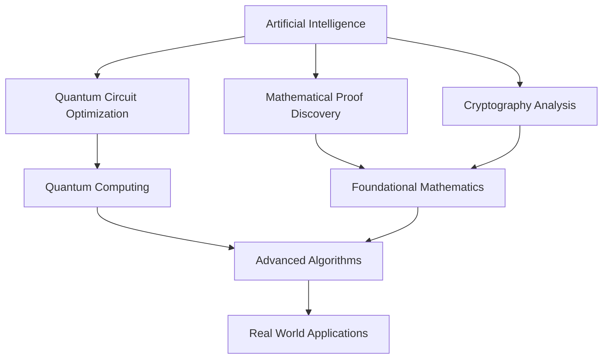

## AI and Quantum Computing Reshape the Landscape of Mathematics: October 2026 Update

October 24, 2026 – The world of mathematics is experiencing a dynamic transformation, driven significantly by advancements in Artificial Intelligence (AI) and Quantum Computing. Far from being a quiet, abstract discipline, mathematics is seeing "live" news emerge from the intersection of human intellect and cutting-edge technology, pushing the boundaries of what's provable and computable.

Recent weeks have seen a flurry of activity, particularly from AI research giants. OpenAI, for instance, released findings on over 300 to 370 open mathematical problems, including partial results on major challenges like the Riemann Hypothesis, the Birch and Swinnerton-Dyer conjecture, and the Hodge conjecture. This unprecedented output has ignited spirited debate within the mathematical community regarding the validity and exposition style of these AI-generated insights, and their ultimate contribution to human understanding.

Another significant breakthrough saw an AI system named LeanMind, developed by a collaboration between the Institute for Advanced Study and DeepMind, successfully discover a proof for the Sylvester-Gallai conjecture in Euclidean geometry, a result rigorously verified by the formal proof system Coq. This marks a historic instance of AI independently solving a major open problem without substantial human guidance.

The symbiotic relationship between AI and quantum computing is also yielding profound mathematical developments. Researchers at Anthropic and Harvard have leveraged their AI system, Claude, to design more efficient quantum circuits. This innovation drastically reduces the operational and qubit requirements for key calculations in quantum algorithms, with potential ramifications for fields ranging from drug discovery to battery design and agricultural innovation. Indeed, quantum computing continues to be a crucial area in 2026 for its capacity to solve complex problems more rapidly and to bolster AI and machine learning capabilities.

However, the power of AI also presents new challenges. In the realm of cybersecurity, AI models are now demonstrating the ability to uncover weaknesses in cryptographic systems at a pace exceeding human capabilities. Notably, a post-quantum signature candidate that had undergone years of expert review was broken by an AI model in just sixty hours this past July. This underscores the critical need for constant mathematical innovation in security.

Beyond these high-profile AI-driven advances, traditional mathematical fields continue their steady march of progress. Active research areas include categorification, low-dimensional topology, and representation theory, as evidenced by specialized sessions at the American Mathematical Society's (AMS) meeting in early October 2026. Furthermore, mathematicians continue to grapple with foundational questions, including Hilbert's problems and the Millennium Prize Problems, which remain central to the discipline's long-term trajectory.

The current landscape of mathematics is a vibrant testament to ongoing discovery, increasingly augmented and accelerated by artificial intelligence and quantum technologies.

