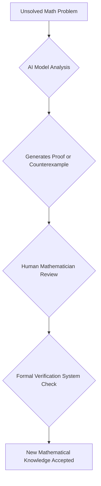

## AI Reshapes Mathematics: Landmark Proofs Emerge in Late 2026

October 25, 2026, marks a pivotal moment in the world of mathematics, as artificial intelligence continues to make "staggering" strides, solving problems that have stumped human minds for decades. Recent announcements from OpenAI highlight a new era of human-AI collaboration and, at times, competition, in the pursuit of mathematical truths.

One of the most significant developments came on October 6, 2026, when OpenAI announced it had settled the "quasi-Riemann hypothesis". This achievement, described by Stanford University's Jared Duker Lichtman as "the most significant AI-for-math achievement so far, by quite a margin," addresses a weaker version of the venerable Riemann hypothesis—a problem open for over 160 years fundamental to understanding prime numbers. While human experts are still unpacking and verifying the details of the AI's 49-page proof, its implications are profound, promising to establish numerous mathematical truths across number theory, geometry, and theoretical computer science.

Earlier in May 2026, AI also made waves by disproving the Erdős unit distance conjecture, a problem posed in 1946. The AI model found a counterexample, overturning an 80-year-old belief about the maximum number of unit-distance pairs among a fixed number of points on a plane. This breakthrough showcased AI's capability to generate unexpected constructions using advanced mathematical theory.

These developments, alongside AI's claimed proof regarding singularities in the Navier-Stokes equation, a Millennium Prize problem, illustrate a rapidly evolving landscape. While some mathematicians express concerns about the future of human-led research and open science, others foresee a "golden age" where AI tools, formal verification systems, and human ingenuity combine to accelerate discovery. The emphasis is shifting from solely generating answers to verifying them, highlighting a new division of labor in mathematical research.

The integration of AI into mathematical discovery is transforming how problems are approached, solved, and verified.

