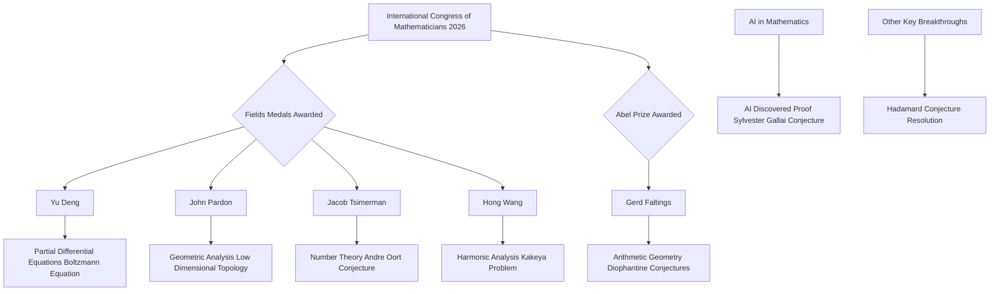

## Mathematics in the Limelight: A Look at Recent Groundbreaking Achievements (October 2026)

As October 2026 draws to a close, the world of mathematics continues to buzz with recent monumental achievements, particularly the announcements of its most prestigious awards and the conclusion of its largest global gathering. This year has celebrated foundational work, recognized emerging brilliance, and seen significant breakthroughs, including the growing impact of artificial intelligence in discovery.

The biggest news dominating the mathematical landscape this year was the **International Congress of Mathematicians (ICM) 2026**, held from July 23-30 in Philadelphia, USA. This quadrennial event serves as a crucial hub for global mathematical collaboration and discovery.

At the heart of the ICM was the awarding of the **Fields Medals**, often considered the "Nobel Prize of Mathematics," given to outstanding mathematicians under 40. The 2026 Fields Medalists, announced on July 23, are:
*   **Yu Deng** (University of Chicago), recognized for his profound contributions to partial differential equations, including the rigorous derivation of the Boltzmann equation from hard-sphere dynamics, and work related to Hilbert's Sixth Problem.
*   **John Pardon** (Stony Brook University), honored for his pioneering work in geometric analysis and low-dimensional topology.
*   **Jacob Tsimerman** (University of Toronto), awarded for his breakthroughs in number theory, particularly his work on the André-Oort conjecture.
*   **Hong Wang** (New York University and IHES), cited for major advances in Fourier restriction and settling the three-dimensional Kakeya conjecture. Notably, Wang is the third woman to receive this esteemed award.

Earlier in the year, the **Abel Prize 2026** was awarded to German mathematician **Gerd Faltings** on May 26, for his introduction of powerful tools in arithmetic geometry and the resolution of long-standing Diophantine conjectures of Mordell and Lang. Faltings, already a Fields Medalist from 1986, is now the first German mathematician to have been honored with both prestigious awards, underscoring his monumental influence in the field.

Beyond these accolades, other significant developments in mathematics have emerged:
*   **AI-Discovered Proofs**: A historic milestone was reached with an AI system named LeanMind, in collaboration with the Institute for Advanced Study and DeepMind, discovering a proof for the Sylvester-Gallai conjecture in Euclidean geometry. This formally verified proof marks the first time a major open problem was solved by AI without substantial human guidance.
*   **Hadamard Conjecture**: The Hadamard conjecture was resolved for all orders greater than 4 by researchers from Oxford and MIT, utilizing combinatorial design theory and quantum annealing.

These events highlight a vibrant and active mathematical community, pushing the boundaries of knowledge through both traditional rigorous proof and innovative computational approaches.

