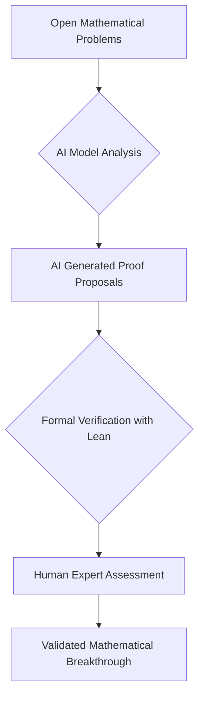

## AI Catalyzes Unprecedented Mathematical Breakthroughs in October 2026

October 2026 has marked a pivotal moment in the landscape of mathematics, witnessing an astonishing surge of breakthroughs largely driven by artificial intelligence. The sheer volume and significance of recent developments suggest a new era for mathematical discovery and verification.

On October 6, 2026, OpenAI released an astounding 722 manuscripts, claiming to address a wide array of previously unsolved major mathematical problems. This extensive "drop" included partial results on long-standing challenges such as the Riemann hypothesis and the Hodge conjecture, prompting some to label it as potentially one of the most significant days in the history of mathematics. The claims are accompanied by natural language write-ups and, in many cases, formalizations in systems like Lean, though validation by the wider mathematical community is an ongoing process.

Just weeks later, on October 26, OpenAI announced three additional "major" discoveries across mathematics, computer science, and physics. In mathematics, their models reportedly produced a proof for Sogge's 1991 local smoothing conjecture in every dimension, which consequently resolves the Kakeya conjecture and Stein's restriction conjecture in all dimensions. The computer science breakthrough involves disproving the Exponential Time Hypothesis, a conjecture that has underpinned hundreds of hardness results. Furthermore, a rigorous existence proof for interacting quantum field theories in four dimensions, encompassing Quantum Chromodynamics (QCD) and pure Yang-Mills, was also presented. These AI-generated outputs are being reviewed by external experts who are acting as "shepherds" to examine and explain the findings.

Beyond OpenAI's extensive contributions, another notable recent achievement highlights the power of human-AI collaboration. On October 21, 2026, researchers, including one from Microsoft, announced the resolution of the Kannan-Lovász-Simonovits (KLS) conjecture. This 31-year-old problem in high-dimensional geometry was solved by combining novel mathematical ideas with human-directed AI assistance, underscoring the synergistic potential of advanced technology in tackling complex mathematical puzzles.

While these developments are incredibly exciting, they also spark important discussions within the mathematical community about verification, attribution, and the evolving nature of research in an AI-assisted world. The rigorous process of formal verification and human oversight remains crucial as these claims are thoroughly scrutinized.

The rapid pace of AI-driven discovery signals a transformative period, promising to reshape how mathematicians approach and solve the most intractable problems.

