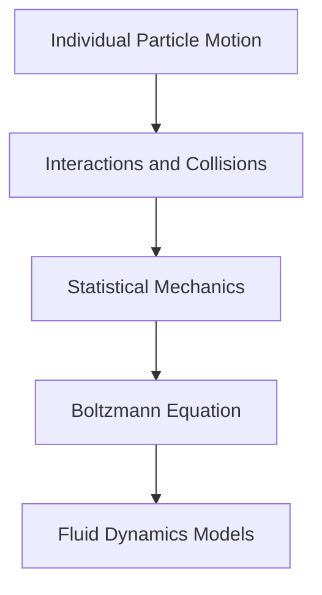

## Fields Medals Crown Mathematical Excellence at ICM 2026

October 29, 2026 — The mathematical world is still buzzing with excitement following the announcements of the 2026 Fields Medals, presented earlier this year at the International Congress of Mathematicians (ICM) in Philadelphia. Widely considered the highest honor in mathematics for those under 40, the medals recognize outstanding mathematical achievement and the promise of future accomplishment.

The prestigious awards were bestowed upon four brilliant mathematicians on July 23, 2026: Yu Deng of the University of Chicago, John Pardon of Stony Brook University, Jacob Tsimerman of the University of Toronto, and Hong Wang from New York University and the Institut des Hautes Études Scientifiques. Their groundbreaking contributions span diverse areas, pushing the boundaries of what is known in the mathematical sciences.

For instance, Yu Deng was recognized for his profound work in partial differential equations, notably for the rigorous derivation of the Boltzmann equation from hard-sphere dynamics for rarefied gases. This achievement provides a crucial mathematical bridge between the microscopic behavior of particles and the macroscopic description of fluids.

The 2026 Fields Medals highlight the depth, originality, and vitality of contemporary mathematics, inspiring new generations to tackle the most ambitious questions.

Here's a simplified view of the connection between microscopic particle interactions and macroscopic fluid dynamics, as addressed by some of the awarded research:

