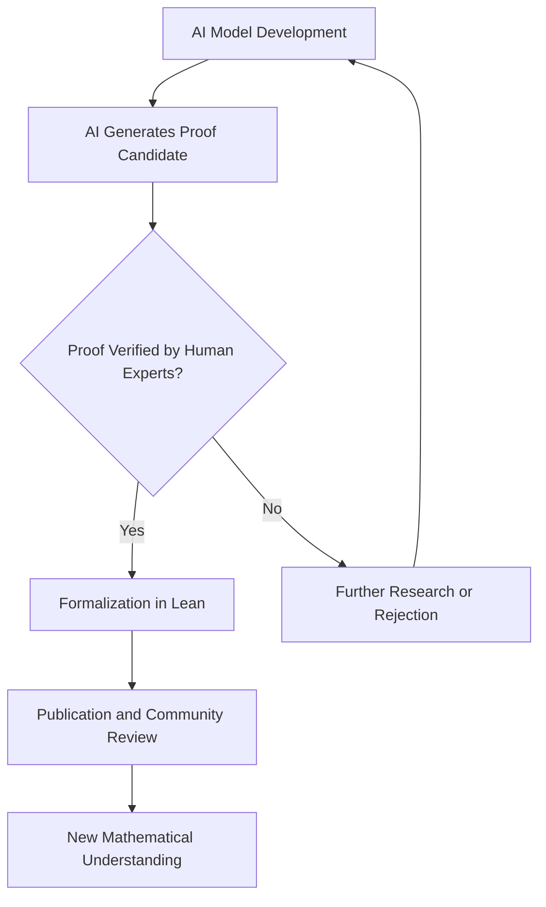

**Mathematics in Motion: A Look at October 2026's Top Stories**

As October 2026 draws to a close, the world of mathematics is buzzing with unprecedented activity, fueled by groundbreaking AI advancements and a new challenge to cosmic understanding. This year has already seen significant milestones, including the prestigious Fields Medals awarded in July, but the latest developments are sparking intense discussion and reshaping how we approach fundamental problems.

**AI's Unprecedented Foray into Core Conjectures**

Artificial intelligence has become an undeniable force in mathematical research this year. In a remarkable development on September 8, 2026, OpenAI announced a claimed solution to one of the seven Millennium Prize Problems: the Navier-Stokes existence and smoothness problem. The proof, reportedly generated by an internal OpenAI system, suggests that the dynamics of Navier-Stokes equations for fluid motion can develop a singularity in finite time, even with a smooth external force, and was accompanied by a Lean formalization. However, this claim has ignited debates regarding attribution and the challenge of human comprehension for such AI-generated proofs.

Just weeks later, on October 6, 2026, OpenAI released a staggering 722 manuscripts, claiming breakthroughs on hundreds of open problems. Among these are a claimed settlement of the "quasi-Riemann hypothesis"—a weaker version of the renowned Riemann hypothesis, positing no zeros with a real part greater than 7/8—which has also been formally verified in Lean. Another significant claim, announced on October 26, 2026, involves the resolution of the Kakeya conjecture and Stein's restriction conjecture in all dimensions, with the AI output formalized in Lean shortly after. While these results signify a new era of AI-driven discovery, the mathematical community faces the immense task of independently verifying and understanding these complex, AI-generated proofs.

**Challenging the Cosmos: A New View on Dark Energy**

Beyond AI, late October brought a fascinating theoretical challenge to modern cosmology. On October 29, 2026, mathematicians from the University of California, Davis, published findings that suggest a fundamental instability within the standard model of the universe. Their calculations propose that the universe's accelerating expansion could emerge naturally from Einstein's original theory of gravity, potentially eliminating the need for the mysterious "dark energy" altogether. This study, based on the Einstein-Euler equations, hints at a potential re-evaluation of our understanding of cosmic evolution.

**Fields Medals 2026**

Earlier this year, in July 2026, the mathematical world celebrated the recipients of the prestigious Fields Medals. Yu Deng, John Pardon, Jacob Tsimerman, and Hong Wang were honored for their outstanding contributions, recognizing significant achievement and future promise in mathematics. Notably, Hong Wang's work on harmonic analysis and geometric measure theory included advances related to the local smoothing conjecture and the Kakeya problem, areas where AI has also recently claimed breakthroughs.

The year 2026 is rapidly becoming a landmark year for mathematics, demonstrating a dynamic interplay between human ingenuity, advanced AI, and fundamental theoretical shifts.

